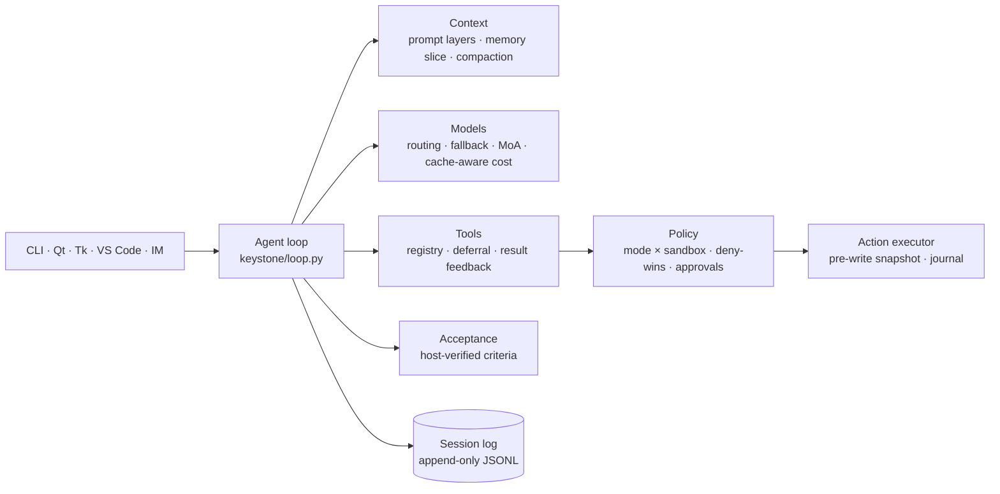

# Pledge Keystone

**An AI assistant that runs on your own computer, does real work for you, and keeps every promise it makes about safety.**

[](https://www.python.org/)
[](.)
[](.)
[](LICENSE)

**English** · [中文](README.zh.md)

---

## In one minute

Most AI chat apps can only *talk*. Pledge Keystone can also *act*: read and edit files, run checks, search the web, operate a chosen window, and hand work to helper agents. It does that within rules you set:

- **It asks before doing anything risky.** Every action goes through a permission check. A "no" rule always wins.
- **Mistakes can be undone.** Before it changes a file, it takes a snapshot that you can roll back to.
- **Your keys stay secret.** API keys live in a separate store, never in config files, and are masked in every log and reply.
- **It checks its own work.** You can attach a list of conditions ("the tests pass", "this file contains X"). The task only counts as done when the computer, not the model, confirms them.
- **It doesn't waste your money.** It picks between cheaper and stronger models, reuses cached prompts, and tells you what each run cost.

You can use the same assistant in several places: a desktop app, VS Code, the command line, WeChat, or an Android phone.


## Try it

| You are on | Do this |
| --- | --- |
| **Windows** | Code → Download ZIP → extract → double-click **`setup.cmd`**. It installs Python if needed, creates a desktop shortcut and opens the app. |
| **macOS / Linux** | Run `./setup.sh` |
| **Any machine with Python 3.10+** | `python run.py selftest`. This runs the full offline check suite against the real kernel, with no key and no network needed. |

To connect a model, run `python run.py setup` (a short wizard) or use the setup guide on the app's welcome screen.

## Why the name

A **keystone** is the wedge at the top of an arch that locks every other stone in place. That is this project's job: one small kernel that keeps models, tools, permissions, memory and every app surface standing together. **Pledge** is the promise it keeps: contracts, permission rules and acceptance checks that can be verified, not just hoped for.

The project used to be called both *Forge* and *pledge-evolving*. Those names are retired. Everything existing installs rely on keeps working (see [Migrating from Forge](#migrating-from-forge)).

---

## For developers

The rest of this file is the engineering view: what the kernel is, how it is built, and how to verify it.

### What it is

A production-shaped **agent kernel written entirely against Python's standard library** (about 42k lines in 129 modules), with front ends on top of it:

| Surface | Start it with | Notes |
| --- | --- | --- |
| CLI | `python run.py <command>` | Scripting, CI and unattended runs. `run.py` is the portable entry point; `python -m keystone.cli` also works on a standard Python. |
| Desktop (Qt) | `keystone-gui/Keystone Qt.cmd` (first run `keystone-gui/desktop/install-qt.ps1`) | Primary chat client. Work mode, a model setup guide, a command palette and approval cards. PySide6 is isolated in `.venv/qt`. |
| Desktop (Tk) + Coding Mode | `python keystone-gui/keystone_gui_v2.py` | A three-column IDE: file tree and Git, a multi-tab editor, an Agent panel, and diff / test / problem panes. |
| VS Code | `vscode-extension/` | Sidebar chat plus explain/review selection, over a local JSONL bridge. |
| IM channel | `python run.py channel weixin serve` | Each inbound message becomes a task; each report becomes a message. |
| Android | Release APK `forge-android-v0.4` | Legacy in-repo copy; development moved to the separate `pledge-steward` repository. |

Every surface goes through the same policy engine, secret boundary and session log. There is no second implementation of "what is allowed".


### Architecture



Every decision is written to `sessions/*.jsonl` (`user_message`, `tool_call`, `subagent_spawn`, `compaction`, `checkpoint`, `assistant_message`, and so on). The log is the source of truth. The index is a cache that `sessions --rebuild` can reconstruct at any time.

### Kernel capabilities

| Area | What actually happens |
| --- | --- |
| **Agent loop** | Bounded prompt layers; context compaction that keeps the tail and stays aware of the prompt cache. Step budget: a transient "N turns left" notice that never enters history, and a tool-free progress summary when the budget runs out. Format errors count only when consecutive and refund their step. Acceptance repairs always keep three turns in reserve. Model retries happen at most once per step, three per run, and honour `Retry-After`. |
| **Tools** | A registry with deferred loading behind `tool_search`. **Result feedback** saves a turn: after a write, `.py` / `.json` / `.toml` files are parsed and conflict markers are flagged in the same result. A missing path gets "did you mean" suggestions. A tool the host refuses as a whole is short-circuited for the rest of the run, with alternatives named once. |
| **Loop guards** | Repeated action/result cycles are detected and stopped. A same-tool streak gets a nudge. An unknown tool outcome stops the run instead of being replayed. |
| **Permissions** | Two-dimensional policy: mode × sandbox tier, plus a command blacklist. **Deny always wins.** Subagents are clamped to the parent's ceiling, and writes are snapshotted with shadow git first. |
| **Secrets** | A separate store and scope: values are virtualised in prompts, redacted in events and results, and tools cannot read the store. |
| **Acceptance** | `keystone run TASK --acceptance FILE.json`: file, command and environment-probe criteria, checked by the host. The model cannot edit the checks. |
| **Model routing** | Economy / balanced / premium tiers, fallback triggered by error class, MoA aggregation, and a premium draft→adjudicate path that falls back to the paid draft. |
| **Cost & cache** | A per-request pricing table, subagent spend folded into the parent ledger, cross-vendor cache-warmth tracking, and compaction deferred while the cache is hot. |
| **Memory** | Typed long-term memory written to two places, a curator that archives instead of deleting, and injection that is always bounded. |
| **Protocol** | A loopback gateway translating Anthropic ↔ OpenAI (Chat and Responses) in both directions, including SSE and tool-call deltas. |
| **Orchestration** | A dependency-free graph runtime: state channels with reducers, a superstep loop, interrupt/resume, checkpoints, and supervisor/worker. |
| **Self-evolution** | Signal → candidate → gate → ledger → rollback. Long-term targets always need human approval, and no setting can bypass it. |
| **Computer use** | The host binds the window, and screenshots stay local (the model sees a digest). Observe/act goes through the same permission chain. Coordinate clicks are tied to a screenshot and confirmed point by point. |

### Engineering principles

1. **Zero kernel dependencies.** The kernel is standard library only. Optional extras (YAML, Qt) stay outside it.
2. **Verifiable by default.** `python run.py selftest` is an offline, end-to-end proof, and the unit suites cover the rest.
3. **Facts in an append-only log.** Sessions, actions and costs are reconstructible, and interrupted actions are never replayed automatically.
4. **Repository text grants nothing.** `AGENTS.md`, tool output and web pages are data. They are never treated as permission.
5. **Contract-gated contributions.** The modules in `keystone/contrib/` were written by seven different AI agents against the frozen [`contract.md`](contract.md). `keystone/registry.py` admits a module only after a static AST scan (no network, subprocess, destructive file APIs or `eval`), an isolated import, and at least eight passing self-checks of its own.

### Configuration

Config is an empty root plus ordered patch layers: `keystone/bundles/*.json` → mode bundles (e.g. `modes/coding.json`) → the user layer `~/.keystone/keystone.patch.json` → `--overlay` files. The last write wins by row id. `python run.py dump-config` shows the result, and `dump-default-config` skips the user layer, so a broken user file can never lock you out.

Loop limits are resolved in one place for every surface (`keystone/loop_limits.py`):

| Key (`loop` row) | Default | Meaning |
| --- | --- | --- |
| `maxSteps` | 12 (40 in coding mode) | Model turns per run. Precedence: request override > user layer > vendor `steps_hint` > bundle. |
| `maxDepth` / `spawnBudget` | 2 / 8 | Subagent depth and how many subagents a run may spawn |
| `wrapUpOnLimit` | `true` | Budget notices plus a final progress summary (skipped when `maxSteps` < 6) |
| `contextChars` | 24000 | Compaction budget, further adjusted per vendor profile |

Keys come from environment variables (`KEYSTONE_<NAME>_KEY`) or the secret store, never from inline config. `doctor` warns about any inline `apiKey`.

### Migrating from Forge

Nothing on disk is moved or rewritten. Old names are only read when the new ones don't exist yet:

| Before | Now | Compatibility |
| --- | --- | --- |
| `~/.forge/` | `~/.keystone/` | An existing `~/.forge` is used when `~/.keystone` is absent. `KEYSTONE_HOME` (or the old `FORGE_HOME`) overrides both. |
| `forge.patch.json`, `forge-desktop.json` | `keystone.patch.json`, `keystone-desktop.json` | The old file is read and written in place until a new one exists |
| `FORGE_*` environment variables | `KEYSTONE_*` | Mirrored both ways at import time, so `env.FORGE_*` expressions in old configs still resolve |
| `forge-plugin.json`, `forge.capability.json`, `<project>/.forge/` | `keystone-plugin.json`, `keystone.capability.json`, `<project>/.keystone/` | Both names are recognised and both are protected |
| `forge` command, `bin/forge.cmd` | `keystone`, `bin/keystone.cmd` | `forge` remains as an alias |
| `import forge` | `import keystone` | No shim; in-repo callers are updated |

What did not change: the Android application id (`com.forge.android`, so installed apps keep upgrading), and archived reports and records (`reports/`, `roundtable/`, `evolution/`, `reviews/` and similar), which keep their historical wording.

### Repository layout

```
pledge-keystone/
├── keystone/              Kernel (stdlib only)
│   ├── loop.py            Agent loop: steps, retries, budgets, acceptance
│   ├── loop_limits.py     One resolver for maxSteps / depth / spawn budget
│   ├── tools.py           Tool registry and built-in tools
│   ├── tool_feedback.py   Post-write checks, path suggestions, tool circuit breaker
│   ├── policy.py          Permissions: mode × sandbox, deny-wins
│   ├── secrets.py         Secret scope, redaction, store boundary
│   ├── model.py routing.py vendors.py adapters.py   Models, routing, vendor profiles
│   ├── gateway.py wire.py openai_responses.py      Protocol gateway and translation
│   ├── session.py checkpoint.py memory.py          Event log, snapshots, memory
│   ├── acceptance.py probes.py                     Host-verified acceptance
│   ├── graph/ scienceclaw/ channels/ development/ contrib/
│   ├── compat.py          Forge → Keystone compatibility (homes, files, env)
│   └── selftest.py cli.py
├── keystone-gui/          Desktop: Qt front end (qt_frontend/), Tk shell + Coding Mode
├── vscode-extension/      VS Code sidebar extension
├── client/                Local web client and run server
├── forge-android/         Legacy Android copy (now developed in pledge-steward)
├── tests/                 Cross-module integration tests
├── bundles/ templates/ scripts/ docs/
└── run.py setup.cmd setup.sh
```

### Testing

```bash
python run.py selftest                                         # offline end-to-end checks
python -m unittest discover -s keystone -p "test_*.py" -t .    # kernel unit tests
python -m pytest -q tests/                                     # integration tests
# Qt front end (needs .venv/qt):
cd keystone-gui && ../.venv/qt/Scripts/python -m unittest qt_frontend.test_backend
```

Set `KEYSTONE_NO_AUTOSTART=1` when running GUI tests so they don't start a real gateway.

### Known limitations

- The standard-library HTTP transport has no connection pooling. A production deployment would swap in a real transport.
- The sandbox guards **writes** and blacklisted programs. It is not kernel-level isolation. **Reads are not sandboxed**: read tools are constrained by declaration and policy rules, not by a path sandbox.
- Explicit `allow` rules outrank the mode baseline (deny still wins). Use sandbox tiers and `deny` rules when you need hard isolation.
- `capability.install` doesn't verify signatures, and memory retrieval is exact match plus recency, with no vector recall.
- The premium two-stage path sends the task and the draft (never the full history) to the adjudicating tier.

### Status

The first commit was on 2026-09-17, and the project is still under heavy development, with one maintainer. The module boundary is frozen by `contract.md`; the public API is not frozen yet. It is published because the design and the contribution gate are worth reading and reusing.

MIT licensed. Project maps: [中文](docs/project-tree.zh.png) · [English](docs/project-tree.en.png).
