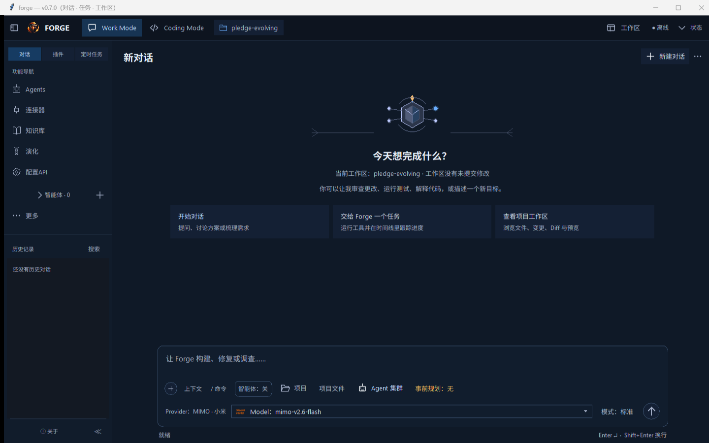
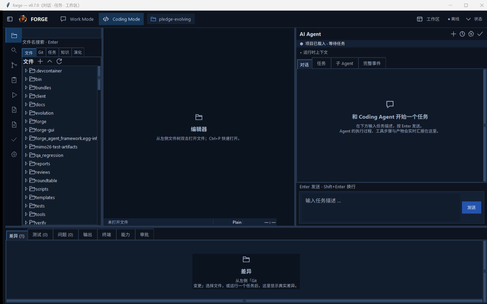
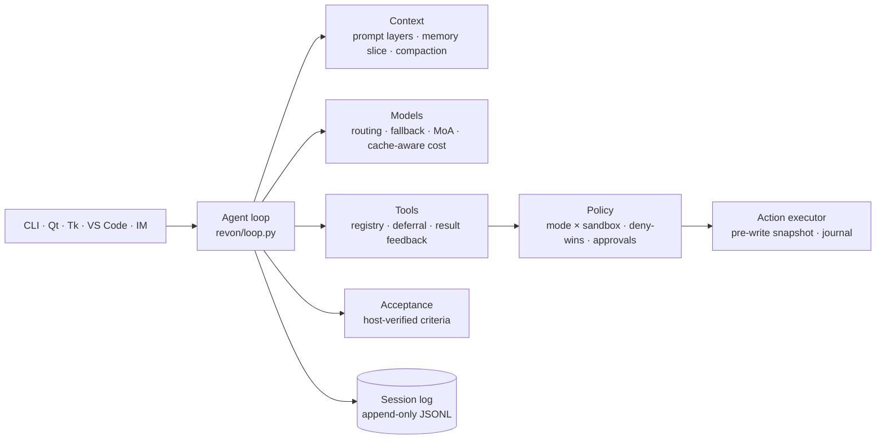

# Pledge revon

**An AI assistant that runs on your own computer, does real work for you, and keeps every promise it makes about safety.**

[](https://www.python.org/)
[](.)
[](.)
[](LICENSE)

**English** · [中文](README.zh.md)

---

## In one minute

Most AI chat apps can only *talk*. Pledge revon can also *act*: read and edit files, run checks, search the web, operate a chosen window, and hand work to helper agents. It does that within rules you set:

- **It asks before doing anything risky.** Every action goes through a permission check. A "no" rule always wins.
- **Mistakes can be undone.** With workspace checkpoints enabled, managed writes first save a recoverable file version.
- **Your keys stay secret.** API keys live in a separate store, never in config files, and are masked in every log and reply.
- **It checks its own work.** You can attach a list of conditions ("the tests pass", "this file contains X"). The task only counts as done when the computer, not the model, confirms them.
- **It doesn't waste your money.** It picks between cheaper and stronger models, reuses cached prompts, and tells you what each run cost.

You can use the same assistant in several places: a desktop app, VS Code, the command line, WeChat, or an Android phone.



## Try it

| You are on | Do this |
| --- | --- |
| **Windows** | Code → Download ZIP → extract → double-click **`setup.cmd`**. It installs Python if needed, creates a desktop shortcut and opens the app. |
| **macOS / Linux** | Run `bash setup.sh qt` for the shared Qt desktop (Python 3.11–3.14), or `bash setup.sh` for the classic launcher. |
| **Any machine with Python 3.10+** | `python run.py selftest`. This runs the full offline check suite against the real kernel, with no key and no network needed. |

To connect a model, run `python run.py setup` (a short wizard) or use the setup guide on the app's welcome screen.

## Why the name

A **revon** is the wedge at the top of an arch that locks every other stone in place. That is this project's job: one small kernel that keeps models, tools, permissions, memory and every app surface standing together. **Pledge** is the promise it keeps: contracts, permission rules and acceptance checks that can be verified, not just hoped for.

The project used to be called *Forge*, *pledge-evolving* and *Keystone* (repository `pledge-keystone`). Those names are retired. Everything existing installs rely on keeps working (see [Migrating from Forge](#migrating-from-forge)).

---

## For developers

The rest of this file is the engineering view: what the kernel is, how it is built, and how to verify it.

### What it is

A production-shaped **agent kernel written entirely against Python's standard library**, with front ends on top of it:

| Surface | Start it with | Notes | Support level |
| --- | --- | --- | --- |
| CLI | `python run.py <command>` | Scripting, CI and unattended runs. `run.py` is the portable entry point; `python -m revon.cli` also works on a standard Python. | Primary |
| Desktop (Qt) | Windows: `revon-gui/revon Qt.cmd` after `revon-gui/desktop/install-qt.ps1`. macOS / Linux: `bash setup.sh qt`. | Primary chat client with Work mode, model setup, a command palette and approval cards. Each OS has its own Qt environment. | Primary |
| Desktop (Tk) + Coding Mode | `python revon-gui/revon_gui_v2.py` | A three-column IDE: file tree and Git, a multi-tab editor, an Agent panel, and diff / test / problem panes. | Experimental |
| VS Code | `vscode-extension/` | Sidebar chat plus explain/review selection, over a local JSONL bridge. | Experimental |
| IM channel | `python run.py channel weixin serve` | Each inbound message becomes a task; each report becomes a message. | Experimental |
| Android | Release APK `forge-android-v0.4` | Legacy in-repo copy; development moved to the separate `pledge-steward` repository. | Experimental |

CLI and Qt desktop are the primary surfaces. Experimental surfaces can have partial feature coverage and can go through different testing from release to release. Qt has launch scripts for macOS and Linux. This desktop regression run covered Windows.



### Architecture



Every decision is written to `sessions/*.jsonl` (`user_message`, `tool_call`, `subagent_spawn`, `compaction`, `checkpoint`, `assistant_message`, and so on). The log is the source of truth. The index is a cache that `sessions --rebuild` can reconstruct at any time.

### Kernel capabilities

| Area | What actually happens | Available in |
| --- | --- | --- |
| **Agent loop** | Bounded prompt layers; context compaction that keeps the tail and stays aware of the prompt cache. Step budget: a transient "N turns left" notice that never enters history, and a tool-free progress summary when the budget runs out. Format errors count only when consecutive and refund their step. Acceptance repairs always keep three turns in reserve. Model retries happen at most once per step, three per run, and honour `Retry-After`. | CLI, Qt Coding |
| **Tools** | A registry with deferred loading behind `tool_search`. **Result feedback** saves a turn: after a write, `.py` / `.json` / `.toml` files are parsed and conflict markers are flagged in the same result. A missing path gets "did you mean" suggestions. A tool the host refuses as a whole is short-circuited for the rest of the run, with alternatives named once. | CLI, Qt Coding, Work tool gateway |
| **Project checks** | `run_check` runs a detected test, lint or build task. Review the command, workspace and timeout before each run, including under full access. | Interactive CLI, Qt Work and Coding |
| **Visual inspection** | `view_image` sends a workspace PNG or JPEG to a vision-capable route. Chat can inspect image attachments from the current conversation. Declare `vision: true` on a custom route or model after verifying image input. | CLI, Qt Coding, Work and Chat |
| **Office and PDF inspection** | `office_render` renders one saved document page or slide into a PNG attachment for a vision model. `read_pdf` extracts the text of a selected PDF page. | Qt Work |
| **Loop guards** | Repeated action/result cycles are detected and stopped. A same-tool streak gets a nudge. An unknown tool outcome stops the run instead of being replayed. | CLI, Qt Coding |
| **Permissions** | Two-dimensional policy: mode × sandbox tier, plus a command blacklist. **Deny always wins.** Subagents are clamped to the parent's ceiling, and managed writes take shadow Git snapshots when checkpoints are enabled. | Kernel entry points |
| **Secrets** | A separate store and scope: values are virtualised in prompts, redacted in events and results, and tools cannot read the store. | Kernel entry points |
| **Acceptance** | `revon run TASK --acceptance FILE.json`: file, command and environment-probe criteria, checked by the host. The model cannot edit the checks. | CLI run |
| **Model routing** | Economy / balanced / premium tiers, fallback triggered by error class, MoA aggregation, and a premium draft→adjudicate path that falls back to the paid draft. | CLI, Qt, gateway |
| **Cost & cache** | A per-request pricing table, subagent spend folded into the parent ledger, cross-vendor cache-warmth tracking, and compaction deferred while the cache is hot. | CLI, Qt Coding |
| **Memory** | Typed long-term memory written to two places, a curator that archives instead of deleting, and injection that is always bounded. | Kernel agent |
| **Protocol** | A loopback gateway translating Anthropic ↔ OpenAI (Chat and Responses) in both directions, including SSE and tool-call deltas. | Local gateway |
| **Orchestration** | A dependency-free graph runtime: state channels with reducers, a superstep loop, interrupt/resume, checkpoints, and supervisor/worker. | CLI, Python API |
| **Self-evolution** | Signal → candidate → gate → ledger → rollback. Long-term targets always need human approval, and no setting can bypass it. | CLI |
| **Computer use** | The host binds the window, and screenshots stay local (the model sees a digest). Observe/act goes through the same permission chain. Coordinate clicks are tied to a screenshot and confirmed point by point. | Qt Computer page after window selection and consent |

Subagent delegation needs a running parent agent to own its budget, cancellation and permission ceiling. The CLI and Qt Coding kernel can supply that parent. Standalone tool gateways and desktop Work tool connections have no parent agent. Work team orchestration is configured separately.

### Engineering principles

1. **Zero kernel dependencies.** The kernel is standard library only. Optional extras (YAML, Qt) stay outside it.
2. **Verifiable by default.** `python run.py selftest` is an offline, end-to-end proof, and the unit suites cover the rest.
3. **Facts in an append-only log.** Sessions, actions and costs are reconstructible, and interrupted actions are never replayed automatically.
4. **Repository text grants nothing.** `AGENTS.md`, tool output and web pages are data. They are never treated as permission.
5. **Contract-gated contributions.** The modules in `revon/contrib/` were written by seven different AI agents against the frozen [`contract.md`](contract.md). `revon/registry.py` admits a module only after a static AST scan (no network, subprocess, destructive file APIs or `eval`), an isolated import, and at least eight passing self-checks of its own.

### Configuration

Config is an empty root plus ordered patch layers: `revon/bundles/*.json` → mode bundles (e.g. `modes/coding.json`) → the user layer `~/.revon/revon.patch.json` → `--overlay` files. The last write wins by row id. `python run.py dump-config` shows the result, and `dump-default-config` skips the user layer, so a broken user file can never lock you out.

Loop limits are resolved in one place for every surface (`revon/loop_limits.py`):

| Key (`loop` row) | Default | Meaning |
| --- | --- | --- |
| `maxSteps` | 12 (40 in coding mode) | Model turns per run. Precedence: request override > user layer > vendor `steps_hint` > bundle. |
| `maxDepth` / `spawnBudget` | 2 / 8 | Subagent depth and how many subagents a run may spawn |
| `wrapUpOnLimit` | `true` | Budget notices plus a final progress summary (skipped when `maxSteps` < 6) |
| `contextChars` | 24000 | Compaction budget, further adjusted per vendor profile |

Keys come from environment variables (`REVON_<NAME>_KEY`) or the secret store, never from inline config. `doctor` warns about any inline `apiKey`.

### Migrating from Forge

Nothing on disk is moved or rewritten. Old names are only read when the new ones don't exist yet:

| Before | Now | Compatibility |
| --- | --- | --- |
| `~/.forge/` | `~/.revon/` | An existing `~/.forge` is used when `~/.revon` is absent. `REVON_HOME` (or the old `FORGE_HOME`) overrides both. |
| `forge.patch.json`, `forge-desktop.json` | `revon.patch.json`, `revon-desktop.json` | The old file is read and written in place until a new one exists |
| `FORGE_*` environment variables | `REVON_*` | Mirrored both ways at import time, so `env.FORGE_*` expressions in old configs still resolve |
| `forge-plugin.json`, `forge.capability.json`, `<project>/.forge/` | `revon-plugin.json`, `revon.capability.json`, `<project>/.revon/` | Both names are recognised and both are protected |
| `forge` command, `bin/forge.cmd` | `revon`, `bin/revon.cmd` | `forge` remains as an alias |
| `import forge` | `import revon` | No shim; in-repo callers are updated |

What did not change: the Android application id (`com.forge.android`, so installed apps keep upgrading), and archived reports and records (`reports/`, `roundtable/`, `evolution/`, `reviews/` and similar), which keep their historical wording.

### Repository layout

| Location | Contents |
| --- | --- |
| `revon/`, `revon-gui/` | Agent runtime and desktop clients |
| `tests/`, `verify/` | Integration tests and independent checks |
| [Design decisions](docs/design.md), [project history](docs/history/) | Architecture rationale, earlier plans and contributor briefs |
| [Module contract](contract.md) | Current contribution interface and admission rules |

```
pledge-revon/
├── revon/              Kernel (stdlib only)
│   ├── loop.py            Agent loop: steps, retries, budgets, acceptance
│   ├── loop_limits.py     One resolver for maxSteps / depth / spawn budget
│   ├── tools.py           Tool registry and built-in tools
│   ├── tool_feedback.py   Post-write checks, path suggestions, tool circuit breaker
│   ├── policy.py          Permissions: mode × sandbox, deny-wins
│   ├── secrets.py         Secret scope, redaction, store boundary
│   ├── model.py routing.py vendors.py adapters.py   Models, routing, vendor profiles
│   ├── gateway.py wire.py openai_responses.py      Protocol gateway and translation
│   ├── session.py checkpoint.py memory.py          Event log, snapshots, memory
│   ├── acceptance.py probes.py                     Host-verified acceptance
│   ├── graph/ scienceclaw/ channels/ development/ contrib/
│   ├── compat.py          Forge → revon compatibility (homes, files, env)
│   └── selftest.py cli.py
├── revon-gui/          Desktop: Qt front end (qt_frontend/), Tk shell + Coding Mode
├── vscode-extension/      VS Code sidebar extension
├── client/                Local web client and run server
├── forge-android/         Legacy Android copy (now developed in pledge-steward)
├── tests/                 Cross-module integration tests
├── bundles/ templates/ scripts/ docs/
└── run.py setup.cmd setup.sh
```

### Testing

```bash
python run.py selftest                                         # offline end-to-end checks
python -m unittest discover -s revon -p "test_*.py" -t .    # kernel unit tests
python -m pytest -q tests/                                     # integration tests
# Qt front end (needs .venv/qt):
cd revon-gui && ../.venv/qt/Scripts/python -m unittest qt_frontend.test_backend
```

Set `REVON_NO_AUTOSTART=1` when running GUI tests so they don't start a real gateway.

### Known limitations

- File read tools check resolved paths against `readScope`. With `auto`, read-only and workspace-write sandboxes confine reads to the workspace, while full access permits account-readable paths. With `workspace`, the workspace and explicitly granted read roots are readable. With `all`, the path gate permits reads outside the workspace. Host secret protections still apply. [Path policy](revon/policy.py)
- Ordinary CLI runs default to the balanced profile with workspace reads. An explicit `--read-scope` overrides the configured scope, which takes precedence over the profile default. Desktop Sandbox confines reads to the workspace. Manual Approval and Full Access select all-path reads, with per-action approval in Manual. An active role may narrow the grant. [CLI profiles](revon/cli.py) · [Desktop grants](revon/desktop_permissions.py)
- These controls run inside revon. An approved shell command or MCP server can access resources available to its process and credentials. Explicit `allow` can lift a mode's default prompt or denial. Explicit denials, read-only write restrictions on classified tools, and path checks take precedence. [Policy evaluation](revon/policy.py)
- General HTTP requests open a connection per request. The Ark Seed gateway can reuse an idle HTTPS connection across consecutive tool rounds. [General transport](revon/http_transport.py) · [Seed transport](revon/seed_transport.py)
- Capability installation records provenance without verifying a publisher signature. Memory recall filters by kind and current status, then orders pinned entries first and newer entries next. Vector retrieval is unavailable. [Capability installation](revon/capability.py) · [Memory recall](revon/memory.py)
- The premium two-stage path sends the task and the draft (never the full history) to the adjudicating tier.

### Engineering roadmap

- Add per-host connection reuse to the general HTTP transport and cover its interaction with timeouts and retries.
- Add publisher signature verification for capability packages and vector retrieval for memory.
- Replay redacted, recorded responses to test HTTP, SSE parsing and provider protocol translation.

### Status

The first commit was on 2026-09-17, and the project is still under heavy development, with one maintainer. The module boundary is frozen by `contract.md`; the public API is not frozen yet. It is published because the design and the contribution gate are worth reading and reusing.

MIT licensed. Project maps: [中文](docs/project-tree.zh.png) · [English](docs/project-tree.en.png).

### Desktop entry points

Use `revon` after installation, or `python run.py` from the checkout. The current-source Windows launcher is `revon-gui/desktop/dist/revon-desktop.exe`. Existing `keystone` commands, Python imports, desktop shortcuts, and local configuration remain supported. New installs use `~/.revon`. An existing `~/.keystone` or `~/.forge` profile is reused in place.
