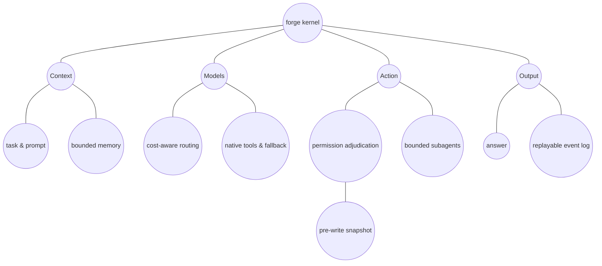

# forge — a unified agent kernel, and a live experiment in contract-driven AI code generation

[](https://www.python.org/)
[](.)
[](.)
[](LICENSE)
[](.)

**forge is a production-shaped agent kernel written entirely against Python's standard library. Twelve of its modules were written by seven different AI agents under a frozen contract, and admitted only after a static security scan and their own self-checks passed.**

Two things make this repository worth a maintainer's time:

1. **It runs with nothing installed.** No `pip install`, no network, no API key. `python run.py selftest` executes 574 end-to-end checks against the real kernel — config synthesis, permission adjudication, tool deferral, memory, session replay, model fallback, protocol gateways, subagent budgets, cost accounting, secret redaction — and prints `574/574 checks passed` on a clean machine.
2. **The contribution model is the experiment.** Twelve modules in [`forge/contrib/`](forge/contrib) were written by seven different agents/tools — Step, Z Code, Trae Work, PI agent, Hermes, WorkBuddy, OpenCode — against [`CONTRACT.md`](CONTRACT.md), a frozen API with hard prohibitions. Claude Code sat as a review seat that read the admitted modules and filed defects instead of writing code. Nothing was admitted on trust: `forge/registry.py` statically rejects network calls, subprocess spawning, destructive file APIs and `eval`, loads the module in isolation, and requires it to pass at least eight self-checks of its own. A module that fails is quarantined with a reason, never half-mounted.

That second point is why this exists: instead of *asking* an AI to write good code and hoping, the repository makes "good" **mechanically checkable**. The result is a real, runnable framework — 43k lines of kernel (122 modules), 46k lines of desktop UI, 263 commits — plus a reusable recipe for anyone putting agents on other people's codebases.

```bash
git clone https://github.com/suyunpledge/pledge-evolving
cd pledge-evolving
python run.py selftest        # 574/574, offline, no API key
```

That is the whole 60-second proof. Everything below is what it checks and why the design choices are what they are.

## See it

Work mode — one input box, the kernel behind it (prompt assembly, routing, tools, permissions):


Coding Mode — a three-column IDE over the same kernel: file tree and Git changes on the left, a multi-tab editor in the centre, the Agent panel on the right, diff / tests / problems / output across the bottom:


Both shots come from an isolated instance with a demo home, so no private data is shown.

## What it does

| Capability | What actually happens |
| --- | --- |
| Agent loop | System prompt assembled from bounded layers (capability index, memory slice, permission state), context compaction that keeps the tail and writes a `compaction` event, deferred tool loading behind `tool_search` |
| Permissions | Two-dimensional policy (mode × sandbox tier) plus a command blacklist; **deny always wins**, subagent modes are clamped by the parent's ceiling, every write passes a shadow-git snapshot first |
| Model routing | Three tiers (economy / balanced / premium), fallback chains triggered by *error class* rather than by guesswork, MoA aggregation, and a premium two-stage path (draft → adjudication) that degrades to the paid draft on any failure |
| Cost | Per-request pricing table with an explicit, documented convention for unknown prices; subagent tokens fold into the parent ledger |
| Memory | Typed long-term memory with dual-write, a curator that archives instead of deleting, and injection that is always bounded |
| Sessions | Append-only JSONL event log as the source of truth, derived index as a rebuildable cache, resume and fork |
| Protocol | Loopback gateway translating Anthropic ↔ OpenAI in both directions, including SSE streaming and tool-call deltas |
| Orchestration | A dependency-free port of graph/superstep semantics: state channels with per-key reducers, interrupt/resume, execution checkpoints, supervisor/worker |
| Self-evolution | Signal → candidate → gate → ledger → rollback; long-term targets always require human approval, no config can bypass it |
| Fleet | Heterogeneous CLI workers described declaratively, dispatched, failure-classified, output-normalised, cost-capped |

## Four entry points, one kernel

| Entry | Start it with | Use it for |
| --- | --- | --- |
| CLI | `python run.py <command>` | Scripting, CI, unattended runs |
| Desktop GUI | `python forge-gui/forge_gui_v2.py` | Day-to-day chat, plus a three-column **Coding Mode** (file tree, multi-tab editor, Agent panel, diff/test/output pages) |
| VS Code extension | install `forge-agent-*.vsix` | Chat, explain/review selected code without leaving the editor |
| IM channel | `python run.py channel weixin serve` | Pick up tasks and read reports from a phone |

All four share the same policy engine, secret boundary and session log. There is no second implementation of "what is allowed".

## Why the code was written by agents (and why the gate matters)

Agent-generated code usually fails in the same three places: it reaches for the network, it shells out, and it invents APIs that do not exist. `CONTRACT.md` freezes the module API up front and lists hard prohibitions; `forge/registry.py` enforces them *statically* before a single line runs:

- AST scan for network, subprocess, destructive filesystem and `eval` usage (including subscript and unpack forms, which are the easy way to smuggle a call past a naive scanner)
- isolated import — a module that raises is quarantined with its traceback, not partially mounted
- the module must ship and pass its own self-checks (≥ 8), so "it imports" is never mistaken for "it works"

The main kernel (the 43k lines outside `contrib/`) was written by the maintainer with AI assistance; the twelve `contrib/` modules are the multi-agent experiment proper. The consistency gate is what makes multiple agents composable. It is also the part most reusable outside this repo: the same pattern works for a team of humans, a team of agents, or any mix.

## Architecture



Every decision lands in `sessions/*.jsonl`: `session_meta`, `user_message`, `tool_decision`, `tool_call`, `subagent_spawn`, `compaction`, `checkpoint`, `assistant_message`. The log is fact; the index is cache — `sessions --rebuild` reconstructs it at any time.

## How it compares

| | forge | LangGraph / CrewAI | Typical agent boilerplate |
| --- | --- | --- | --- |
| Dependencies | none (stdlib only) | framework + provider SDKs | many |
| Verification | 574 offline checks in one command | varies, often network-bound | rarely present |
| Permission model | first-class: mode × sandbox, deny-wins, subagent ceilings | usually delegated to the host | ad-hoc |
| Contribution gate | static scan + isolated import + per-module self-checks | n/a | n/a |
| Cost accounting | per-request pricing, subagent folding | partial | absent |
| Entry points | CLI · desktop · VS Code · IM on one kernel | library only | one |

## Status, honestly

- **Age**: first commit 2026-09-17, still under heavy development (263 commits at the time of writing). The API is not frozen for *users* yet — `CONTRACT.md` freezes the *module* boundary, not the public surface.
- **Adoption**: single maintainer, early stage, no downstream users yet. It is published because the design is worth reading and because the contribution gate is reusable — not because it has a community.
- **Scope discipline**: the 574 checks cover what the repo claims. Known gaps are listed at the bottom of this file rather than hidden; the security model is "sandbox writes + blacklist programs", not kernel-level isolation, and the read side is constrained by declaration rather than by path sandboxing.

## Quick start

```bash
cd pledge-evolving

python run.py selftest            # offline self-checks (574/574, no API key, runs from any clone path)
python run.py dump-config         # inspect the synthesized config tree
python run.py doctor              # health / drift / key checks
python run.py capabilities list   # capability inventory
python run.py run "read the README and summarise it"
python run.py gateway --upstream https://api.deepseek.com --port 8799 --models claude-sonnet-5
python run.py vendors --detect    # vendor difference profiles
python run.py cache status        # cross-vendor cache continuity
python run.py channel list        # IM channel inventory
python run.py review "code or text"  # tool-free review
```

`run.py` is the required entry point: AutoClaw's embedded Python uses a `._pth` layout, so `python -m forge.cli` fails there with `No module named 'forge'`. With a standard Python install, `python -m forge.cli` works fine.

Python ≥ 3.10. Zero third-party dependencies. MIT licensed.

Desktop UI: `python forge-gui/forge_gui_v2.py` (or the shortcut `setup.cmd` creates on Windows). VS Code sidebar: [`vscode-extension/README.md`](vscode-extension/README.md).

### One-click cloud / one-click Windows

- **Cloud**: use the Codespaces badge at the top of this file — nothing to install locally.
- **Windows**: download the repo (Code → Download ZIP, extract), double-click **`setup.cmd`**. It detects Python 3.10+, installs it silently if missing (winget first, python.org installer as fallback), then creates a desktop shortcut and opens the UI. Variants: `setup.cmd check`, `setup.cmd selftest`, `setup.cmd web`.
- **macOS / Linux**: `./setup.sh` with the same variants (Homebrew / apt / dnf / yum / pacman).

---

### A note on non-ASCII paths

The maintainer develops on a Windows machine whose **username contains non-ASCII characters** (a CJK name). All project code therefore avoids `os.getcwd()` assumptions in the places where it matters and resolves paths from `__file__` instead. If your own home directory contains non-ASCII characters:

- `python run.py selftest` and the full test suite run from any path — the test files resolve their imports via `Path(__file__)`, not hardcoded absolute paths (three historical hardcoded paths were replaced in Oct 2026 for exactly this reason).
- The desktop GUI and the VS Code extension were exercised on the CJK-username machine itself, which is the harsher environment: if a path assumption breaks on non-ASCII names, it breaks *here first*. Running on an ASCII-only machine is the easy case.
- What is **not** handled: reports under `docs/` and `reports/` quote historical absolute paths verbatim (they are evidence documents, left as recorded), and the optional local-services examples point at `127.0.0.1` endpoints only.

## v2 additions (0.2.0)

| Module | Borrowed from | What it does |
| --- | --- | --- |
| `evolution.py` | **Hermes** (curator / learning / journey / checkpoints) | Signal extraction → candidates → safety gate → ledger → rollback → metabolism. Long-term goals always need a human nod |
| `federation.py` | Built from scratch this round (all failure modes grew out of real testing) | Descriptors / dispatch / failure classification / output normalization / cost guardrails for heterogeneous CLI workers |
| `wire.py` | The protocol mismatch between Claude Code and MiMo | Bidirectional Anthropic ↔ OpenAI translation, including SSE streaming and incremental tool calls |

Key commands:

```bash
python run.py evolution stats                # Candidate pool + ledger overview (defaults to ~/.forge; use --home . to see the repo's own bundled data)
python run.py evolution observe "From now on, write reports in Chinese" --nominate
python run.py evolution approve <id> && python run.py evolution apply <id>
python run.py evolution rollback <id>        # Reversible
python run.py evolution curate               # Archives expired candidates (never deletes)
python run.py federation roster              # Capability/cost/permission profile for the worker queue (read from the home's federation.json)
python run.py gateway --upstream https://api.example.com/v1 --upstream-wire openai \
    --model-map claude-sonnet-5=<upstream-model> --models claude-sonnet-5 --key $KEY
```

### Four non-negotiable self-evolution rules

1. **Nothing lands without approval**: only low-risk `note`-type candidates can take effect automatically; everything else goes into pending.
2. **Long-term goals always need a human nod**: `MEMORY.md` / `AGENTS.md` / `SOUL.md` / `USER.md` / `TOOLS.md` / `SKILL.md` have no config option to bypass this.
3. **Every write carries provenance**: the target file gets an appended candidate id + timestamp + evidence reference, so it can be traced after the fact.
4. **Archive, never delete**: reject / quarantine / stale are all `restore`-able; another snapshot is taken right before any rollback.

## v3: each agent writes its own module (0.3.0)

The new framework isn't just existing agents strung together — instead, **the interfaces are frozen first, then each agent writes its own module, and the code is merged in against the contract**.

- Contract: [`CONTRACT.md`](CONTRACT.md) — the frozen module API, hard bans, and a ready-to-paste task brief for each agent
- Gate: `forge/registry.py` — statically scans source code (bans network/subprocess/destructive file APIs/`eval`) + dynamic loading + runs the contributed module's own self-checks (≥ 8 assertions)
- Reference example: [`forge/contrib/heartbeat.py`](forge/contrib/heartbeat.py) — the first contrib module admitted, passing all 10 of its own self-checks

```bash
python run.py modules validate    # Consistency snapshot: who's in, who's isolated, and why
python run.py modules selftests   # Runs the self-checks bundled with every admitted module
```

Isolation, not half-mounting: if a contrib module's import throws, or its self-checks fail, or it references a banned library, it gets flagged with a reason and blocked — without affecting the core framework.

## v4: four steps toward a complete architecture (0.4.0)

1. **Native tool calling** (`toolwire.py`) — the main loop moves from "text-protocol only" to **native-first, text-fallback**: tool declarations are generated per-wire, calls are parsed from native fields, and tool results flow back over the same wire **with the call id preserved**. The id matters: in the next request round, the assistant message and the tool message must line up — reconstructing that from prose is just guessing.
2. **Cross-module integration tests** (`selftest:test_contrib_integration`) — the gate only proves each module is valid **in isolation**; this step proves the **seams**: the worker picked by the router must be the same one dispatched to by the team layer, the scheduler's due set must be fed to that same dispatch round, and the compactor must agree with the main loop on what counts as "too big."
3. **Normalizing hook-name drift** (`registry.HOOK_ALIASES`) — three authors, three naming conventions (`due_jobs` / `on_due_check`, `replay` / `on_replay`). Rather than requiring everyone to rename their own code, an alias table resolves to the canonical name, and any drift is recorded as a **warning** in the index.
4. **Cost accounting** (`pricing.py` + `forge cost`) — turns effective unit prices, reverse-derived from two real invoices, into hard numbers, so "who should this task be routed to" can be decided by the numbers.

```bash
python run.py cost rate --models deepseek-flash,mimo-v2.5 --tokens 1273002379
python run.py modules validate        # now includes naming-drift warnings
python run.py selftest                # item counts follow actual output
```

## v4.5: the fix rounds (2026-09-16, signed off round-by-round with an adversarial review seat)

After v4 shipped, it went into fix rounds: each round had its own independent review seat write its own attack probes, and only passed once signed off. Four batches, all cleared; g3's review tally is back to zero:

1. **Static security baseline (H1–H10 closed)**: the contrib gate expanded from "scan imports" to a doubly-closed layer — alias-aware + reference-triggers-block + dunder attribute table + **table-aligned invariants** (CALLS and FROM_NAMES are twin-pinned bidirectionally; an unbalanced table expansion turns the check red on commit). Six root-spelling variants, `operator.attrgetter` laundering, and every `os.*` file-mutation primitive were closed one by one; the number of `gate:*` assertions follows the actual self-test output, and the independent probes are all green.
2. **Tool-host declarations as semantics (F4-2/F4-3)**: `readOnlyHint` is normalized and passed through, `authorize` honors `spec["read_only"]`, and the **declaration takes precedence over name heuristics** — after stripping the `server__` prefix, the heuristic no longer flips; a write tool named `read_*` can no longer sneak past the check.
3. **Baseline semantics for contrib mounting (F2-2/H11)**: `mount_contrib_extensions` uses a dual registry — bundled contrib modules get a baseline seat, while a `home/contrib` module with the same name **only takes over if it passes the gate itself and its hooks resolve**. A rejected file no longer makes the seat silently disappear; takeover/fallback is logged as a warning and a `mount_warning` event fires on the first `run()` (fired only once, not repeatedly).
4. **Router/teams primary keys frozen (F2-3)**: workers/members are keyed by `id` (a single keyspace), with `name` used only for display and sorting; the integration self-test now constructs counter-examples (id ≠ name), so any bug masked by coincidentally-equal values now turns red.
5. **`validate` warning lines (F5-4) + regex cleanup (F5-5)**: `modules validate` now prints `[warn]` lines inline; leftover generation-time regex artifacts in the evolution signal matching have been cleaned up.

## v0.7.0: three-tier smart model routing

Added `forge/routing.py` (SmartRouter, a ModelRouter subclass, with zero changes to the frozen contract). Task-level tier selection, with three strategies:

| Strategy | Routing logic |
| --- | --- |
| `economy` | Walks tiers in ascending order of effective unit price (from `pricing.py`'s invoice-derived rates); only escalates on retriable failures; unknown-priced tiers are treated conservatively and placed last, so they can't be mistaken for a free tier |
| `balanced` | Starts on the mid-tier workhorse; escalates on failure + falls back to the frozen chain as a floor (default) |
| `premium` | Two-stage pipeline: mid-tier drafts → top-tier integrates/adjudicates; any failure in the integration stage (including fatal ones) falls back to the draft — the draft has already been paid for, so it isn't discarded; messages strictly alternate roles (system/user/assistant/user), and the integration tier only receives the original task + the draft, never the full conversation |

```bash
python run.py run "task" --strategy economy      # Explicit CLI override (CLI > config > default balanced)
```

Configured under the `model.routing` block in `bundles/base.json`: `tiers` (the tier table, declared in cost order), `premium` (the integration/adjudication tier), `small` (the miscellaneous-tasks tier — failures here don't escalate, so they can't burn through the review tier). The single authoritative definition of "unknown price = 0.0" in the pricing table is documented in a comment at the top of `pricing.py` — routing interprets it conservatively while budget scaling interprets it generously, and this difference is intentional.

## v0.8.0: declarative plugin capability broker + market

Plugins moved from “import third-party Python” to a **declarative capability broker**
(`forge-gui/plugin_capabilities.py`): the GUI never imports plugin code — a plugin's
`contributions.tools` are registered as local aliases whose execution goes through the
Forge gateway's real Policy again. Grants are per-capability × per-workspace × per-session,
bound to the plugin's content fingerprint; disable/uninstall/edit revokes them.

The desktop market also gained: a read-sandboxed builtin tool bridge, remote catalogs
(Claude official marketplace + ClawHub, 72h-throttled sync with per-source retry), an
adapter for on-machine ecosystems (OpenClaw skills / Claude Code market / DSH bundles /
Codex plugins — declarative, never executed), and an audit log with rotation.

Hardening from the 2026-10-05 full-repo audit: read-path sandbox enforcement (S1),
gateway auth wiring (S2), subagent token folding into the parent cost ledger (S3),
per-session usage events (S4), contribution source-scanner subscript/unpack coverage (S5),
and main-thread chunked rendering / backgrounded persistence against UI freezes.

## 2026-10 capability layers: orchestration, fleet adaptation, channels

After v0.8.0 three layers were added: an **orchestration layer** ported from other frameworks' semantics, an **adaptation layer** so the framework holds up on a mixed fleet and on local engines, and **entry points** beyond the CLI — desktop window, editor extension and IM channels all sit on the same kernel.

| Capability | Module | What it does | Boundary |
| --- | --- | --- | --- |
| Graph orchestration | `forge/graph/` | Dependency-free port of LangGraph semantics: state channels with per-key reducers, Pregel superstep loop, interrupt/resume, Send/Command, execution checkpoints, supervisor/worker | Synchronous, single-threaded, one lane per session; not a distributed scheduler |
| ScienceClaw trio | `forge/scienceclaw/` | Tool results past a threshold are offloaded to workspace files (the agent sees a summary and a path), PlanStep normalisation, reasoning extraction unified across three vendor formats | Offloaded files stay inside the workspace |
| Mixed-fleet adaptation | `vendors.py` `adapters.py` `cache_state.py` `context_plan.py` `local_service.py` | Cliff-vs-slope long-context costing, cross-vendor cache continuity, per-request optimal plan, local-engine branches (ollama / llamacpp / mnn) | The local branch is gated on an explicit `service` field; a typo is treated as cloud |
| Batch jobs | `batch_execution.py` | Submit / status / results / cancel for OpenAI-compatible Batch APIs; plans and jobs persist without credentials | No polling loop, no automatic POST retry, no local execution of returned tool calls |
| IM channels | `forge/channels/` | A two-method `poll()` / `send()` contract plus a WeChat implementation: an inbound message becomes a task, the report becomes a message | The channel does not own the agent loop |
| Desktop & editor | `desktop_services.py` `vscode_bridge.py` `vscode-extension/` | Desktop jobs and mediated connectors (credentials from a trusted host callback, every write confirmed per invocation); the editor talks over a local JSONL bridge | A permission gate, not an OS sandbox; the bridge opens no listening socket |
| Hardening | `runtime_lock.py` `execution_guard.py` `project_rules.py` `code_review.py` | OS advisory locks for cooperating processes (never scan-as-lock), action/observation loop detection (interrupted actions are never auto-replayed), bounded AGENTS.md reading, tool-free review | Repository text can never grant capability; review findings are not authority |

### Coding Mode (`forge-gui/development_mode/`)

The desktop window holds two workspaces: Work is chat, Coding is a three-column IDE.

| Area | Contents |
| --- | --- |
| Left | A 48px activity bar (files / search / git / tasks / run / knowledge / evolution / approvals / settings) plus five views: file tree, Git changes, tasks, knowledge, evolution |
| Centre | Multi-tab editor: line-number gutter, current-line highlight, find/replace, read-only split mirror, breadcrumbs and a cursor / encoding / EOL / language status row; welcome page with no project, a centred empty-state card with no open file |
| Right | Agent panel: conversation / tasks / sub-agents / full events, a collapsible runtime-context band (permission matrix · model routing · task control), unified input area (Enter sends, queue capped at 3) |
| Bottom | Seven full-width pages: diff / tests / problems / output / terminal / capabilities / approvals, counters read from real sources |
| Layout presets | Code Focus / Agent Focus / Review Focus — the same component set, only sash weights and content emphasis change |

The visual layer has a single source, `gui_theme.py`: rounded cards and centred empty states, `dev_button` with consistent hover/pressed/disabled feedback, a compact Explorer tab metric. Editor actions grey out when no document is open instead of leaving a primary button pointing at nothing.

## Local inference services (ollama / llamacpp / mnn)

A few adaptations that make a *self-hosted* engine usable are wrong for a cloud provider, so they are gated behind an optional `service` field on the provider row. Absent or unrecognised means "not local" and nothing below applies — a typo can never reroute a provider.

The gate follows the provider `model.primary` names (or, when it is unset, the first provider carrying a default model — the same one the router will try first). An unresolvable primary resolves to "not local": an unknown must not switch the gate on.

```json
{"id": "local", "name": "provider:local",
 "config": {"service": "ollama", "wire": "openai",
            "baseURL": "http://127.0.0.1:11434", "model": "qwen3:8b"}}
```

What the gate changes, and why (both measured against Ollama 0.34.0 serving qwen3:8b):

| Gate | Local engine | Everything else |
| --- | --- | --- |
| Chat / tool-loop path | `/v1/chat/completions` (a bare `host:port` base URL gains the `/v1` segment) | `/chat/completions`, unchanged |
| Thinking mode | `off` unless explicitly set to `on`; `smart` is downgraded | the configured mode, untouched |
| Thinking output budget | always bounded (ceiling `LOCAL_THINKING_CAP`, overridable downward via `thinking.tokenCap`) | never touched |

Reasons, in order: the native chat surface rejects a replayed `tool_calls` history with HTTP 400, so a multi-turn tool loop has to use the OpenAI-compatible path; and a small local model's contemplation can fail to converge (measured: 420 s with no answer), which a bounded output budget cuts off cheaply. Cloud providers keep their existing base path and behaviour.

## Seven frameworks → one landing spot

| Source framework | Design borrowed | Landing module | Self-test anchor |
| --- | --- | --- | --- |
| **DeepSeek Harness** | Empty root + ordered patch layers, last-write-wins by id, whole-line replacement instead of deep merge, `dump-default` recovery channel, `$expr` lazy expressions | `config.py` | `config:*` |
| **Codex** | Three-tier sandbox tied to approvals, rollout JSONL event stream (`session_meta` + ordinal), resume/fork, versioned & rebuildable derived index, point-path overrides + strict mode | `policy.py` `session.py` | `session:*` |
| **Hermes Agent** | Fallback chains triggered by error type, MoA multi-slot aggregation, shadow-git checkpoints and rollback, curator that only archives (never deletes), skill provenance | `model.py` `checkpoint.py` `memory.py` | `model:*` (3) `checkpoint:*` (3) |
| **OpenClaw** | Layered system-prompt assembly, context-compaction thresholds and compaction events, bounded-slice memory injection, subagent depth/budget/output detoxification, serialized sessions | `loop.py` `memory.py` | `loop:*` |
| **OpenCode** | Provider-as-data (`provider[] + model + small_model`), unified wire adapter layer, keys never live in config files | `model.py` `cli.py` | `model:*` `doctor:*` |
| **Claude Code** | CLI output shapes (`-p` non-interactive / structured output), permission-mode enum, layered settings with overrides | `cli.py` `policy.py` | `cli:*` |

Design rationale, alternatives that were rejected, and the reasoning behind each trade-off are in [`DESIGN.md`](DESIGN.md). The seat-anchor counts for each source framework (e.g. `config:*`) grow with every fix round; they follow the actual `selftest` output and are intentionally not hardcoded here.

## What the kernel looks like

```
Task
 └─ Agent.run()                     loop.py
      ├─ System prompt assembly  ← capability index + memory slice + permission state (all bounded)
      ├─ Context compaction      ← folds the middle section once past the threshold, keeps the tail, logs a compaction event
      ├─ ModelRouter              ← primary model → fallback chain by error type → (optionally) MoA aggregation
      ├─ Tool calling             ← Defer hides by default → tool_search activates → permission adjudication → execution
      │    └─ Before write ops    → CheckpointStore shadow snapshot
      └─ spawn_subagent           ← independent context / depth ceiling / budget / permission ceiling / output detoxification
```

Every decision is logged into `sessions/*.jsonl`: `session_meta`, `user_message`, `tool_decision`, `tool_call`, `subagent_spawn`, `compaction`, `checkpoint`, `assistant_message`. The log is the fact; the index is a cache — rebuild it anytime with `sessions --rebuild`.

## Five non-negotiables

1. **Deny always wins**: no matter how permissive the mode or how bold the subagent, explicit deny rules and command blacklists take precedence over every other adjudication.
2. **Subagents cannot escalate privileges**: a subagent's mode is capped by its parent session's ceiling; a subagent spawned under a `plan`-mode parent can never obtain `bypassPermissions`.
3. **The user layer can be entirely stripped out**: `dump-default-config` skips the user layer, so a broken user config can never permanently lock out startup.
4. **Archive, never delete**: the curator only marks agent-built knowledge as archived; `restore` is always reversible.
5. **Keys never live in config files**: `doctor` flags an inline `apiKey` directly as a warning; providers go through environment variables or the loopback gateway.

## Directory Layout

```
pledge-evolving/
├── forge/                      Kernel (standard library only, no third-party dependencies)
│   ├── config.py               Empty root + patch-layer synthesis (DSH)
│   ├── policy.py               Two-dimensional permissions + three-tier sandbox + command blacklist
│   ├── tools.py                Tool registration + lazy loading + ToolSearch
│   ├── capability.py           Unified contract for skills / plugins / connectors
│   ├── memory.py               Typed dual-write memory + curator
│   ├── compaction.py           Context-compaction strategy
│   ├── context_plan.py         Long-context decision: lossless vs compressed (cliff/slope costing)
│   ├── subagent.py             Subagent orchestration: spawning / budget / output sanitisation
│   ├── thinking.py             Deliberation engine: budget / convergence / three-tier mode
│   ├── session.py              Append-only event log + derived index + fork
│   ├── model.py                Provider abstraction + fallback chain + MoA
│   ├── routing.py              Three-tier smart routing (economy / balanced / premium)
│   ├── vendors.py              Vendor difference profiles (single vs mixed fleet)
│   ├── adapters.py             Per-vendor adapters: the optimal plan for one request
│   ├── cache_state.py          Cross-vendor cache continuity
│   ├── local_service.py        Local-engine branches (ollama / llamacpp / mnn)
│   ├── batch_execution.py      Explicit Batch job lifecycle
│   ├── checkpoint.py           Shadow-git snapshots and rollback (Hermes)
│   ├── loop.py                 Agent main loop (OpenClaw / CodeBuddy)
│   ├── gateway.py              Loopback protocol gateway
│   ├── wire.py                 Anthropic ↔ OpenAI protocol translation
│   ├── toolwire.py             Native tool-calling protocol adapter
│   ├── federation.py           Heterogeneous CLI federation dispatch
│   ├── evolution.py            Self-evolution
│   ├── registry.py             Contrib-module registry + consistency gate
│   ├── pricing.py              Cost accounting
│   ├── guard.py                Shared security ban table
│   ├── execution_guard.py      Action/observation loop detection (never auto-replays)
│   ├── runtime_lock.py         OS advisory locks for cooperating processes
│   ├── project_rules.py        Bounded AGENTS.md reading
│   ├── code_review.py          Tool-free review
│   ├── desktop_services.py     Desktop jobs and mediated connectors
│   ├── vscode_bridge.py        Local JSONL bridge for editors
│   ├── graph/                  Graph orchestration: channels / superstep loop / interrupt / checkpoint / supervisor
│   ├── scienceclaw/            Tool-result offload / PlanStep / reasoning extraction
│   ├── channels/               IM channel contract + WeChat implementation
│   ├── development/            Coding Mode backend: editor model / runtime / evidence / state
│   ├── contrib/                Agent-authored contribution modules (isolated by the consistency gate)
│   ├── selftest.py             Offline verification suite
│   └── cli.py                  Command-line entry point
├── forge-gui/                  Desktop GUI: Work / Coding workspaces
│   ├── forge_gui_v2.py         Work workspace + host shell
│   ├── development_mode/       Coding Mode (app / welcome / explorer / editor / agent_panel / layout / bottom_panel)
│   ├── gui_theme.py            Single source of visual tokens
│   └── plugin_capabilities.py  Declarative plugin capability broker
├── vscode-extension/           VS Code sidebar extension (nine commands + webview panel)
├── bundles/                    Config layers: base.json / modes/coding.json
└── docs/                       Architecture and acceptance documents
```

## Known Limitations

- `gateway` and `model.HttpTransport` use standard-library HTTP with no connection pooling or retry/backoff policy; a production deployment would need to swap in a real transport.
- The principle behind permission adjudication is "the sandbox intercepts **write** paths + the blacklist intercepts programs," not kernel-level isolation (on Windows, true shell confinement would require restricted tokens / ACLs). **Reads are not sandboxed**: `read_file` / `list_dir` / `grep` can read paths outside the workspace (relative, absolute, or `..` — all resolved as-is). Convergence on the read side relies on declaration (the `read_only` annotation during toolhost normalization and `authorize`'s decision) and runtime allowlisting, not a path sandbox; scenarios needing read isolation should declare read tools as read-only and constrain them at the `deny`/`ask` layer.
- **`allow` rules always outrank the mode baseline** (except deny): in `read-only` mode, an explicit `allow` rule for a write-class tool will let it through — mode is a baseline, not a hard ceiling; this is intentional semantics, not a defect. Scenarios that need read-only to be a hard isolation guarantee should use sandbox tiers and `deny` rules instead.
- `capability.install` only does versioned directory writes with no signature verification; supply-chain auditing would need to hook into something like OSV externally.
- Memory retrieval is exact match + recency/pinned ordering, with no vector recall — hooking up a vector store is an obvious next step.
- `read_only` is declarative, not enforced — a write tool marked `read_only=True` will bypass both the sandbox path check and the read-only-mode write gate (a WB-P2 authorize-declaration trust gap; currently limited in impact since the toolhost isn't mounted at runtime).
- The premium two-stage pipeline sends **the draft and the original task** to the integration/adjudication tier (informed use: configuring a premium tier implies consent to this data flow); the full conversation history is never sent out.
- `mount_contrib_extensions`'s dual registry covers the static gate and hook resolvability as a fallback; runtime hook exceptions are caught as a fallback inside `_use_extension` (it does not fall back to the bundled module) — scenarios needing "a bad hook never takes the seat" would require runtime-degraded retry instead (complex; logged as a known gap, not implemented).
- `teams.deliver`'s `to` direction only supports id-based addressing (no name→id resolution), while the `from` direction supports unique name-based resolution — this asymmetry is intentional and safe, but note: `to` cannot use a display name.


---

## 项目结构图谱 / Project Tree Map

- 中文：[项目结构图谱](docs/project-tree.zh.png)
- English: [Project tree map](docs/project-tree.en.png)
- 分层拆解与中英对照：[docs/PROJECT-TREE.md](docs/PROJECT-TREE.md)