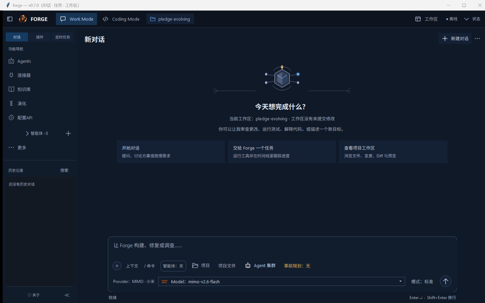
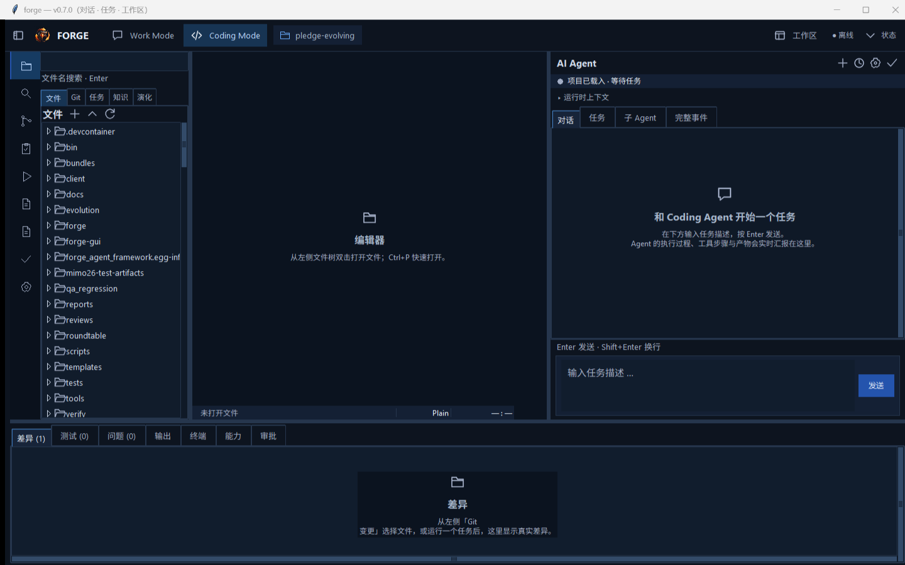
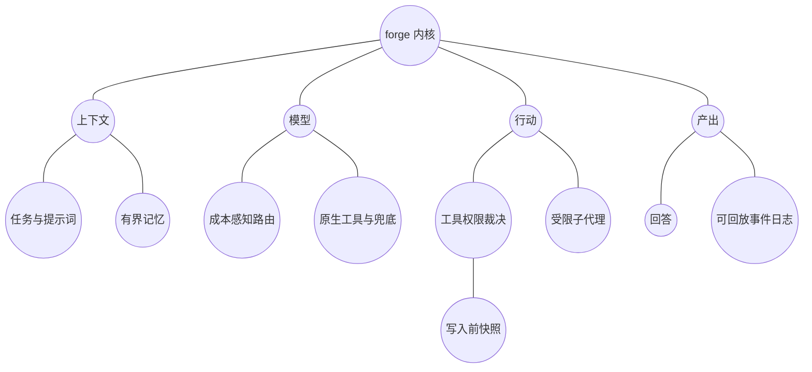

# forge — 统一智能体内核，以及一次「契约驱动的 AI 写码」实证

[](https://www.python.org/)
[](.)
[](.)
[](LICENSE)
[](.)

**forge 是一套只用 Python 标准库写完的智能体内核；其中 12 个模块由 7 个不同的 AI agent 在冻结契约下写成，只有通过静态安全扫描并跑过自带自检才被准入。**

这个仓库有两点值得花时间看：

1. **什么都不装就能跑。** 不用 `pip install`、不联网、不需要 API Key。`python run.py selftest` 对真实内核执行全套端到端检查（当前五百余项）——配置合成、权限裁决、工具延迟加载、记忆、会话回放、模型降级、协议网关、子代理预算、成本核算、密钥脱敏——干净机器上直接打印 `574/574 checks passed`。
2. **贡献模型本身就是实验。** [`forge/contrib/`](forge/contrib) 下的 12 个模块由 7 个不同的 agent / 工具（Step、Z Code、Trae Work、PI agent、Hermes、WorkBuddy、OpenCode）对着 [`CONTRACT.md`](CONTRACT.md) 的冻结 API 与硬性禁令写成；Claude Code 坐在交叉审查席，只读已入库模块、只交缺陷报告，不写代码。没有任何模块靠信任入库：`forge/registry.py` 静态拒绝网络调用、子进程、破坏性文件 API 与 `eval`，隔离加载，且模块必须自带并通过至少 8 条自检。不合格的模块带原因隔离，绝不半挂载。

第二点是这套东西存在的理由：与其**要求** AI 写出好代码再祈祷，不如让「好」变成**机器可判定**的。结果是一个真能跑的框架——内核 43k 行（122 个模块）、桌面 UI 46k 行、263 次提交——外加一套可以直接搬到别人代码库上的做法。

```bash
git clone https://github.com/suyunpledge/pledge-evolving
cd pledge-evolving
python run.py selftest        # 574/574，离线，不需要 API Key
```

这就是全部 60 秒验证。下面写的是它检查了什么、以及每个设计选择为什么这么定。

## 先看界面

Work 模式——一个输入框，背后是内核（提示组装、路由、工具、权限）：



Coding Mode——同一个内核上的三栏 IDE：左侧文件树与 Git 变更，中央多标签编辑器，右侧 Agent 面板，底部差异 / 测试 / 问题 / 输出：



两张图都来自隔离实例（演示用 home），不包含任何私有数据。

## 它能做什么

| 能力 | 实际发生的事 |
| --- | --- |
| 智能体主循环 | 系统提示按有界层组装（能力索引、记忆切片、权限状态），上下文压缩保留尾部并写 `compaction` 事件，工具默认延迟、经 `tool_search` 激活 |
| 权限 | 二维策略（mode × 沙箱档）+ 命令黑名单；**deny 恒胜**，子代理模式被父会话天花板钳制，任何写入先落影子 git 快照 |
| 模型路由 | 三档（economy / balanced / premium），降级链按**错误类型**触发而非靠猜，MoA 聚合，premium 走两阶段（草稿 → 裁决）且裁决段任何失败都退回已付费草稿 |
| 成本 | 逐请求计价表，未知价有明确且写进代码的约定；子代理 token 折进父账本 |
| 记忆 | 类型化长期记忆双写，curator 只归档不删除，注入恒有界 |
| 会话 | 追加式 JSONL 事件日志是事实源，派生索引是可重建缓存，支持 resume 与 fork |
| 协议 | 环回网关双向翻译 Anthropic ↔ OpenAI，含 SSE 流式与工具调用增量 |
| 编排 | 零依赖移植图/超步语义：per-key reducer 的 state channels、interrupt/resume、执行检查点、supervisor/worker |
| 自我进化 | 信号 → 候选 → 闸门 → 账本 → 回滚；长期目标永远要人点头，没有配置能绕开 |
| 异构机队 | CLI worker 声明式描述、派发、失败分类、输出归一、成本护栏 |
| 电脑操作 | Windows 上宿主选定的窗口绑定：截图只留在内存（模型永远拿不到原始像素），原生控件观察/操作走同一条权限链，可选的视觉分析需逐次云端授权，坐标点击逐点确认后派发 |

## 四个入口，一个内核

| 入口 | 怎么起 | 干什么 |
| --- | --- | --- |
| CLI | `python run.py <命令>` | 脚本化、CI、无人值守 |
| 桌面 GUI | `python forge-gui/forge_gui_v2.py` | 日常对话，外加三栏 **Coding Mode**（文件树、多标签编辑器、Agent 面板、差异/测试/输出页） |
| VS Code 扩展 | 安装 `forge-agent-*.vsix` | 不离开编辑器就能对话、解释/审查选中代码 |
| IM 通道 | `python run.py channel weixin serve` | 手机侧接任务、读报告 |

四个入口共用同一套策略引擎、密钥边界与会话日志——「什么被允许」只有一份实现。

## 为什么让 agent 写代码（以及闸门为什么重要）

agent 生成的代码通常死在同一处三连：乱伸手访问网络、偷偷起子进程、编造不存在的 API。`CONTRACT.md` 先把模块 API 冻结、把硬禁令列清；`forge/registry.py` 在任何一行代码执行之前**静态**强制它：

- AST 扫描网络、子进程、破坏性文件系统与 `eval`（覆盖下标与解包形式——这是绕过朴素扫描器最省事的路子）
- 隔离 import：抛异常就带 traceback 隔离，不会半挂载
- 模块必须自带并跑过 ≥ 8 条自检，「能 import」永远不会被误当成「能工作」

主内核（`contrib/` 之外的 43k 行）是维护者在 AI 辅助下写的；12 个 `contrib/` 模块才是真正的多 agent 实验。这套一致性闸门是多个 agent 能协同的原因，也是最容易搬出本仓库复用的部分：同一套模式对一群真人、一群 agent、或人与 agent 混编都成立。

## 架构



每一次决策都落进 `sessions/*.jsonl`：`session_meta`、`user_message`、`tool_decision`、`tool_call`、`subagent_spawn`、`compaction`、`checkpoint`、`assistant_message`。日志是事实，索引是缓存——`sessions --rebuild` 随时重建。

### 电脑操作，全程短链拴住

Windows 桌面控制是有的，而且每一步都是刻意设计：

1. **宿主**选窗口（选择器只列出带标题的顶层窗口——无像素、不改焦点）。模型永远不能自己指定目标 HWND。
2. **截图留在本地。** 采集跑在有界工作进程里（PrintWindow，≤1600 万像素、PNG ≤8 MiB）；模型拿到的是尺寸和 SHA-256 摘要——永远不是图片字节。
3. **视觉分析逐次授权。** 只有显式勾选授权后，所选视觉模型才能看到当前截图；换窗口或换模型即撤销；重启后不残留任何状态。
4. **原生控件 observe/act**（`computer_observe` / `computer_act`）与其它工具走同一条 ToolRegistry、Policy、ActionExecutor 链：单次观察引用 30 秒过期、状态指纹检测漂移、逐动作宿主审批、每次动作后重新观察。密码框与只读框屏蔽；不支持的控件不公布动作。
5. **坐标点击绑定截图。** `computer_click(x, y, reason)` 只接受与绑定窗口某次观察绑定的坐标；确认弹窗会展示带落点标记的截图，人工确认后才派发一次原生左键单击。像素漂移、窗口移动、DPI 变化或过期都会使点击失效；未知结果直接停止运行而不是重放。
6. 没有全桌面回退、不在活的桌面上猜坐标、没有失败自动重放。宿主撤销会话时不需要等待 I/O。

## 和常见方案的区别

| | forge | LangGraph / CrewAI | 常见的 agent 样板 |
| --- | --- | --- | --- |
| 依赖 | 无（纯标准库） | 框架 + 各家 SDK | 很多 |
| 验证 | 一条命令全套离线检查（五百余项） | 不等，常需联网 | 通常没有 |
| 权限模型 | 一等公民：mode × 沙箱、deny 恒胜、子代理天花板 | 多交给宿主 | 临时拼 |
| 贡献闸门 | 静态扫描 + 隔离加载 + 模块自带自检 | 不涉及 | 不涉及 |
| 成本核算 | 逐请求计价，子代理折算 | 部分 | 无 |
| 入口 | CLI · 桌面 · VS Code · IM 同一内核 | 只有库 | 通常一个 |

## 状态，如实说

- **年龄**：首次提交 2026-09-17，仍在密集开发（本文写作时 263 次提交）。面向用户态 API 尚未冻结——`CONTRACT.md` 冻结的是**模块**边界，不是公开接口。
- **采用度**：单人维护、早期阶段、暂无下游用户。公开的原因是设计值得一读、贡献闸门可以复用，而不是因为它已有社区。
- **范围纪律**：离线检查覆盖的就是仓库声称的东西（项数以 selftest 实际输出为准）；已知缺口列在文末而不是藏起来。安全模型是「沙箱拦写入 + 黑名单拦程序」，不是内核级隔离；读侧靠声明约束而非路径沙箱。

## 快速开始

```bash
cd pledge-evolving

python run.py selftest            # 离线自检（574/574，不需要 API Key，任意克隆路径可跑）
python run.py dump-config         # 看合成出的配置树
python run.py doctor              # 健康/漂移/密钥检查
python run.py capabilities list   # 能力清单
python run.py run "读一下 README 并总结"
python run.py gateway --upstream https://api.deepseek.com --port 8799 --models claude-sonnet-5
python run.py vendors --detect    # 厂商差异档案
python run.py cache status        # 跨厂商缓存连续性
python run.py channel list        # IM 通道清单
python run.py review "代码或文本"  # 无工具审查
```

`run.py` 是必需的入口：AutoClaw 内嵌 Python 用 `._pth` 布局，`python -m forge.cli` 会报 `No module named 'forge'`；标准 Python 环境下 `python -m forge.cli` 可用。

Python ≥ 3.10，零第三方依赖，MIT 许可。

桌面界面：`python forge-gui/forge_gui_v2.py`（Windows 也可用 `setup.cmd` 创建的快捷方式）。VS Code 侧边栏见 [`vscode-extension/README.md`](vscode-extension/README.md)。

### 一键云端 / Windows 一键配置

- **云端**：点顶部 Codespaces 徽章，浏览器里直接用。
- **Windows**：下载仓库（Code → Download ZIP，解压）后双击 **`setup.cmd`**——自动探测 Python 3.10+，缺失则静默安装（优先 winget，回退 python.org），随后创建桌面快捷方式并打开界面。变体：`setup.cmd check` / `selftest` / `web`。
- **macOS / Linux**：`./setup.sh`，变体同上（Homebrew / apt / dnf / yum / pacman）。

---

### 关于非 ASCII 路径

维护者的开发机是 Windows，**用户名本身含非 ASCII 字符**（中文姓名）。因此项目代码在要紧的位置一律用 `__file__` 相对解析、不依赖 `os.getcwd()` 假设。如果你自己的用户目录也含非 ASCII 字符：

- `python run.py selftest` 与全部测试套件可从任意路径运行——测试文件通过 `Path(__file__)` 解析导入，不再硬编码绝对路径（2026 年 10 月已为此替换掉三处历史硬编码）。
- 桌面 GUI 与 VS Code 扩展就是在这台中文用户名机器上开发与验证的——这是更苛刻的环境：路径假设若在非 ASCII 用户名上出问题，会**先在这里暴露**。纯 ASCII 机器反而是容易的情形。
- **不处理**的部分：`docs/` 与 `reports/` 下的报告按历史原样引用绝对路径（它们是证据文档，保持记录原貌）；可选的本地推理示例只指向 `127.0.0.1` 端点。

## v2 新增（0.2.0）

| 模块 | 学谁 | 干什么 |
| --- | --- | --- |
| `evolution.py` | **Hermes**（curator / learning / journey / checkpoints） | 信号抽取 → 候选 → 安全闸门 → 账本 → 回滚 → 代谢。long-term 目标永远要人点头 |
| `federation.py` | 本轮自建（失败模式都是从实测里长出来的） | 异构 CLI worker 的描述符 / 派发 / 失败分类 / 输出归一 / 成本护栏 |
| `wire.py` | Claude Code + MiMo 的协议错配 | Anthropic ↔ OpenAI 双向翻译，含 SSE 流式与工具调用增量 |

新命令：

```bash
python run.py evolution stats                # 候选池与账本概览（默认读 ~/.forge；看仓库自带数据用 --home .）
python run.py evolution observe "以后都用中文写报告" --nominate
python run.py evolution approve <id> && python run.py evolution apply <id>
python run.py evolution rollback <id>        # 可逆
python run.py evolution curate               # 归档过期候选（不删除）
python run.py federation roster              # worker 队列的能力/成本/权限档（从 home 的 federation.json 读取）
python run.py gateway --upstream https://api.example.com/v1 --upstream-wire openai \
    --model-map claude-sonnet-5=<upstream-model> --models claude-sonnet-5 --key $KEY
```

### 自我进化的四条硬规矩

1. **无批准不落地**：只有 low-risk 的 `note` 类候选能自动生效；其余一律进 pending。
2. **long-term 目标永远需要人点头**：`MEMORY.md` / `AGENTS.md` / `SOUL.md` / `USER.md` / `TOOLS.md` / `SKILL.md` 没有配置可以绕开。
3. **写入必带出处**：目标文件里附 candidate id + 时间 + 证据引用，事后可追溯。
4. **归档而非删除**：reject / quarantine / stale 全部可 `restore`；回滚前再快照一次。

## v3：代码由各家 agent 自己写（0.3.0）

新框架不是把现有 agent 串起来，而是**先冻结接口，再让每家 agent 各写一个模块，按契约把代码合到一起**。

- 契约：[`CONTRACT.md`](CONTRACT.md) —— 冻结的模块 API、硬性禁令、每个 agent 的即贴任务书
- 闸门：`forge/registry.py` —— 静态扫源码（禁网/禁子进程/禁破坏性文件 API/禁 `eval`）+ 动态加载 + 跑对方自带自检（≥ 8 条）
- 范本：[`forge/contrib/heartbeat.py`](forge/contrib/heartbeat.py) —— 第一份入库的贡献模块，10 条自检全过

```bash
python run.py modules validate    # 一致性截面：谁入库、谁隔离、为什么
python run.py modules selftests   # 跑所有已入库模块自带的断言
```

隔离而非半挂载：贡献模块导入抛异常、或自检有失败、或引用了禁用库，都会被记录原因后拦住，不影响框架本体。

## v4：向完整架构的四步（0.4.0）

1. **原生工具调用**（`toolwire.py`）——主循环从「只会说文本协议」改成 **原生优先、文本兜底**：工具声明按 wire 生成，调用从原生字段解出，工具结果按同一 wire 回流并**保留调用 id**。id 很重要：下一轮请求里助手消息与工具消息必须对得上，用散文重建是猜的。
2. **跨模块集成测试**（`selftest:test_contrib_integration`）——闸门只证明每份模块**单独**合格，这一条证明**接缝**：路由器挑中的 worker 必须是团队层投递到的那个人，调度器的到期集必须喂给同一次派发，压缩器必须和主循环对「多大算大」有同一个答案。
3. **钩子名漂移的规范化**（`registry.HOOK_ALIASES`）——三个作者三套命名（`due_jobs` / `on_due_check`，`replay` / `on_replay`）。不要求别人改自己代码里的名字，而是用别名表解析规范名，并把漂移记成**警告**写进索引。
4. **成本核算**（`pricing.py` + `forge cost`）——把两张真实账单反推的有效单价固化下来，让「同一件事派给谁」可以按数字决定。

```bash
python run.py cost rate --models deepseek-flash,mimo-v2.5 --tokens 1273002379
python run.py modules validate        # 现包含命名漂移警告
python run.py selftest                # 项数以实际输出为准
```

## v4.5：修复轮（2026-09-16，与对抗复验席逐轮签收）

v4 交付后进入修复轮：每一轮都由独立复验席自写探针攻击、签收后才进下一轮。四个批次全清（P0/P1/P2 + H11），g3 评审账面归零：

1. **静态安全线（H1–H10 关闭）**：贡献闸门从「扫 import」扩成双层闭合——别名感知 + 引用即拦 + dunder 属性表 + **表对齐不变量**（CALLS 与 FROM_NAMES 孪生双向钉死，扩表漏配提交即红灯）。根拼写六变体、`operator.attrgetter` 洗白、`os.*` 文件变更原语逐条闭环；`gate:*` 断言数以自测实际输出为准，独立探针全绿。
2. **工具宿主声明即语义（F4-2/F4-3）**：`readOnlyHint` 经归一透传，`authorize` 接受 `spec["read_only"]` 且**声明优先于名字启发**；`server__` 前缀剥离后启发不翻转——写工具叫 `read_*` 不再绕过判定。
3. **贡献挂载保底语义（F2-2/H11）**：`mount_contrib_extensions` 双注册表——包内 contrib 保底席位，`home/contrib` 同名模块**只有自己过闸且钩子可解析才接管**；被拒文件不再让席位静默消失，接管/保底记警告并首次 `run()` 发 `mount_warning` 事件（只发一次，不重复）。
4. **router/teams 主键冻结（F2-3）**：worker/member 以 `id` 为主键（同一键空间），`name` 只作显示与排序；集成自检改反值构造（id ≠ name），同值掩盖从此翻红。
5. **validate 警告行（F5-4）+ 正则清理（F5-5）**：`modules validate` 就地打印 `[warn]` 行；evolution 信号正则清除生成期串味残留。

## v0.7.0：三档模型智能路由

新增 `forge/routing.py`（SmartRouter，ModelRouter 子类，冻结契约零改动）。任务级选档，三种策略：

| 策略 | 路由逻辑 |
| --- | --- |
| `economy` | 按有效单价升序走档（pricing.py 账单反推价），仅可重试失败才上浮；未知价保守殿后，不被当免费档打穿 |
| `balanced` | 中端主力档首发，失败向上升级 + 冻结 chain 兑底（默认） |
| `premium` | 两阶段流水：中端出草稿 → 高端集成裁决；集成段任何失败（含 fatal）都降级回草稿——草稿已付费不弃；消息形状严格角色交替（system/user/assistant/user），集成档只收原任务+草稿，完整对话不外流 |

```bash
python run.py run "任务" --strategy economy      # CLI 显式指定（> 配置 > 默认 balanced）
```

配置在 `bundles/base.json` 的 `model.routing` 块：`tiers`（档位表，按成本序声明）、`premium`（集成裁决档）、`small`（杂务档，失败不上浮烧不到审查档）。计价表未知价=0.0 的单一权威定义见 `pricing.py` 顶部注释（routing 取保守解释、预算缩放取宽松解释，有意不同）。

## v0.8.0：声明式插件能力代理 + 插件市场

插件从“import 第三方 Python”改为**声明式能力代理**（`forge-gui/plugin_capabilities.py`）：GUI 不再 import 插件代码 —— 插件的
`contributions.tools` 只注册为本地别名，执行仍经 Forge 网关的真实 Policy 裁决。授权按能力 × 工作区 × 会话逐项绑定插件内容指纹；禁用/卸载/改文件即撤销。

桌面市场同时新增：读沙箱限定的内置工具桥、远程目录（Claude 官方市场 + ClawHub，72 小时节流同步、按源重试）、本机生态适配层（OpenClaw 技能 / Claude Code 市场 / DSH bundles / Codex 插件 —— 声明式，不执行），以及带轮转的审计日志。

2026-10-05 全仓审查的加固：读路径沙箱执行（S1）、网关鉴权接线（S2）、子代理 token 折进父成本账（S3）、会话用量事件（S4）、贡献源码扫描覆盖下标/解包（S5），以及主线程分批渲染 / 持久化后台化防 UI 冻结。

## 2026-10 能力层：编排、机队适配、通道

v0.8.0 之后长出三层东西：把别家编排语义移植进来的**编排层**、让框架在混合机队和本地引擎上不发虚的**适配层**，以及命令行之外的**多入口**——桌面窗口、编辑器插件、IM 通道都接在同一个内核上。

| 能力 | 模块 | 干什么 | 边界 |
| --- | --- | --- | --- |
| 图编排 | `forge/graph/` | LangGraph 语义的零依赖移植：state channels 与 per-key reducer、Pregel 超步循环、interrupt/resume、Send/Command、执行检查点、supervisor/worker | 同步单线程、每会话一路；不是分布式调度器 |
| ScienceClaw 三件套 | `forge/scienceclaw/` | 工具结果超阈值外置成文件（agent 只见摘要与路径）、PlanStep 规范化、三家 reasoning 格式统一提取 | 外置文件落在工作区内 |
| 混合机队适配 | `vendors.py` `adapters.py` `cache_state.py` `context_plan.py` `local_service.py` | 长上下文「断崖 vs 斜坡」的成本判断、跨厂商缓存连续性、单请求最优计划、本地引擎专属分支（ollama / llamacpp / mnn） | 本地分支靠 provider 行的 `service` 显式声明，写错一律按云端处理 |
| 批量作业 | `batch_execution.py` | OpenAI 兼容 Batch API 的提交 / 查询 / 取结果 / 取消；计划与作业落盘不含凭据 | 不轮询、不自动重试 POST、不在本地执行返回的工具调用 |
| IM 通道 | `forge/channels/` | `poll()` / `send()` 两方法契约 + 微信实现：入站消息变任务、报告变消息 | 通道不持有 agent 循环 |
| 电脑操作 | `computer_use.py` `computer_win32.py` `computer_capture.py` `forge-gui/computer_panel.py` | 宿主选定窗口上的作用域 observe→act 运行时：单次观察引用带 TTL、状态指纹、逐动作宿主审批、失败不自动重放；截图绑定坐标点击（逐点人工确认）；原生 Button/Edit 控件驱动（无全局输入，密码框屏蔽）；有界内存截图采集，无全桌面回退；Work 模式面板提供窗口选择器与可选视觉模型分析 | 目标 HWND 由宿主选择、模型不能指定；原始截图留在本地，云端视觉需逐次显式授权；不支持的控件不公布动作 |
| 桌面与编辑器 | `desktop_services.py` `vscode_bridge.py` `vscode-extension/` | 桌面作业与中介连接器（凭据由宿主回调提供，写操作逐次确认）；编辑器走本地 JSONL 桥 | 是权限闸门，不是 OS 沙箱；桥不开监听端口 |
| 工程加固 | `runtime_lock.py` `execution_guard.py` `project_rules.py` `code_review.py` | 协作进程用 OS 咨询锁（不拿扫描当锁）、动作/观察循环检测（中断动作不自动重放）、AGENTS.md 有界读取、无工具审查 | 仓库文本永远不会授予能力；审查结论不是权威 |

### Coding Mode（`forge-gui/development_mode/`）

桌面窗口是双工作空间：Work 是对话，Coding 是三栏 IDE。

| 区域 | 内容 |
| --- | --- |
| 左栏 | 48px 活动栏（文件 / 搜索 / Git / 任务 / 运行 / 知识 / 演化 / 审批 / 设置）+ 文件树、Git 变更、任务、知识、演化五个视图 |
| 中央 | 多标签编辑器：行号槽、当前行高亮、搜索替换、分屏只读镜像、面包屑与行列 / 编码 / 换行 / 语言状态行；无项目时是欢迎页，无打开文件时是居中空态卡 |
| 右栏 | Agent 面板：对话 / 任务 / 子 Agent / 完整事件四页，运行时上下文折叠带（权限矩阵 · 模型路由 · 任务控制），底部统一输入区（Enter 发送、队列上限 3） |
| 底部 | 全宽七页：差异 / 测试 / 问题 / 输出 / 终端 / 能力 / 审批，计数徽标取真实数据源 |
| 布局预设 | Code Focus / Agent Focus / Review Focus——同一套组件，只改 sash 权重与内容侧重 |

视觉层单一来源是 `gui_theme.py`：圆角卡与居中空态、`dev_button` 统一三态反馈、Explorer 紧凑 Tab 度量；无打开文档时编辑器工具动作置灰，不拿主色按钮指向虚无。

## 本地推理引擎（ollama / llamacpp / mnn）

有几条让自托管引擎能用的适配，放到云端 provider 上全是错的，所以它们被 provider 行上一个可选的 `service` 字段挡住。缺省或不认识就是「非本地」，下面全部不生效——写错一个字母不会把 provider 改道。

闸门认的是 provider `model.primary` 指向的名字（未设置时取第一个带默认模型的 provider，也就是路由器会先试的那个）。解析不出来一律按「非本地」处理：未知不能把闸门打开。

```json
{"id": "local", "name": "provider:local",
 "config": {"service": "ollama", "wire": "openai",
            "baseURL": "http://127.0.0.1:11434", "model": "qwen3:8b"}}
```

闸门改了什么、为什么（两条都是对着 Ollama 0.34.0 跑 qwen3:8b 测出来的）：

| 闸门 | 本地引擎 | 其它 |
| --- | --- | --- |
| 对话 / 工具循环路径 | `/v1/chat/completions`（只写 `host:port` 的 base URL 会补上 `/v1`） | `/chat/completions`，不变 |
| 沉思模式 | 除非显式设 `on`，否则 `off`；`smart` 降级 | 按配置，不动 |
| 沉思输出预算 | 恒有界（上限 `LOCAL_THINKING_CAP`，可用 `thinking.tokenCap` 往下压） | 不碰 |

原因按顺序：原生 chat 面回放模型自己的 `tool_calls` 历史会直接 HTTP 400，多轮工具循环只能走 OpenAI 兼容面；小号本地模型的沉思可能不收敛（实测 420 秒没结果），有界输出预算能便宜地截断。云端 provider 的 base 路径与行为原样保留。

## 七套框架 → 一处落点

| 借鉴对象 | 被吸收的设计 | 落点模块 | 自检锚点 |
| --- | --- | --- | --- |
| **DeepSeek Harness** | 空根 + 有序补丁层、按 id 后写胜、整行替换不做深合并、`dump-default` 恢复通道、`$expr` 惰性表达式 | `config.py` | `config:*` |
| **Codex** | 三档沙箱绑审批、rollout JSONL 事件流（`session_meta` + ordinal）、resume/fork、派生索引版本化可重建、点路径覆盖 + 严格模式 | `policy.py` `session.py` | `session:*` |
| **Hermes Agent** | fallback 链按错误类型触发、MoA 多槽聚合、影子 git 检查点与回滚、curator 只归档不删除、技能 provenance | `model.py` `checkpoint.py` `memory.py` | `model:*` (3) `checkpoint:*` (3) |
| **OpenClaw** | 系统提示分层组装、上下文压缩阈值与压缩事件、记忆有界切片注入、子代理深度/预算/结果去毒、会话串行 | `loop.py` `memory.py` | `loop:*` |
| **OpenCode** | provider 即数据（`provider[] + model + small_model`）、统一 wire 适配层、密钥不进配置文件 | `model.py` `cli.py` | `model:*` `doctor:*` |
| **Claude Code** | CLI 输出形态（`-p` 非交互 / 结构化输出）、权限模式枚举、设置分层与覆盖 | `cli.py` `policy.py` | `cli:*` |

设计原则、被否掉的方案、以及每一条的取舍理由见 [`DESIGN.md`](DESIGN.md)。各借鉴对象的席位锚点（`config:*` 等）计数随每轮修复增长，以 `selftest` 实际输出为准，此处不逐个硬编码。

## 内核长什么样

```
任务
 └─ Agent.run()                     loop.py
      ├─ 系统提示组装  ← 能力索引 + 记忆切片 + 权限状态（都有界）
      ├─ 上下文压缩    ← 超阈值折叠中段、保留尾部，写 compaction 事件
      ├─ ModelRouter   ← 主模型 → 按错误类型降级链 →（可选）MoA 聚合
      ├─ 工具调用      ← Defer 默认隐藏 → tool_search 激活 → 权限裁决 → 执行
      │    └─ 写操作前 → CheckpointStore 影子快照
      └─ spawn_subagent ← 独立上下文 / 深度上限 / 预算 / 权限天花板 / 输出去毒
```

每一次决策都落进 `sessions/*.jsonl`：`session_meta`、`user_message`、`tool_decision`、`tool_call`、`subagent_spawn`、`compaction`、`checkpoint`、`assistant_message`。日志是事实，索引是缓存 —— `sessions --rebuild` 随时重建。

## 五个"不妥协"

1. **deny 恒胜**：无论 mode 多宽、无论子代理多大胆，显式 deny 与命令黑名单先于一切裁决。
2. **子代理不得越权**：子代理的 mode 会被父会话天花板钳制；`plan` 父会话里的子代理不可能拿到 `bypassPermissions`。
3. **用户层可整层摘除**：`dump-default-config` 跳过用户层，配置写坏永远不会锁死启动。
4. **归档而非删除**：curator 只把 agent 自建知识标记为 archived，`restore` 可逆。
5. **密钥不进配置文件**：`doctor` 会把内联 `apiKey` 直接报为告警，provider 走环境变量或环回网关。

## 目录

```
pledge-evolving/
├── forge/                      内核（纯标准库，零第三方依赖）
│   ├── config.py               空根 + 补丁层合成（DSH）
│   ├── policy.py               二维权限 + 三档沙箱 + 命令黑名单（CodeBuddy / Codex）
│   ├── tools.py                工具注册 + 延迟加载 + ToolSearch
│   ├── capability.py           skills / plugins / connectors 统一契约
│   ├── memory.py               类型化记忆双写 + curator
│   ├── compaction.py           上下文压缩策略
│   ├── context_plan.py         长上下文取舍：无损 vs 压缩（断崖/斜坡成本）
│   ├── subagent.py             子代理编排：派生 / 预算 / 输出净化
│   ├── thinking.py             沉思引擎：预算 / 收敛 / 三档模式
│   ├── session.py              追加式事件日志 + 派生索引 + fork
│   ├── model.py                provider 抽象 + 降级链 + MoA
│   ├── routing.py              三档智能路由（economy / balanced / premium）
│   ├── vendors.py              厂商差异档案（单机队 vs 混合机队）
│   ├── adapters.py             逐厂商适配器：单请求的最优计划
│   ├── cache_state.py          跨厂商缓存连续性
│   ├── local_service.py        本地推理引擎分支（ollama / llamacpp / mnn）
│   ├── batch_execution.py      显式 Batch 作业生命周期
│   ├── checkpoint.py           影子 git 快照与回滚（Hermes）
│   ├── loop.py                 agent 主循环（OpenClaw / CodeBuddy）
│   ├── gateway.py              环回协议网关
│   ├── wire.py                 Anthropic ↔ OpenAI 协议翻译
│   ├── toolwire.py             原生工具调用协议适配
│   ├── federation.py           异构 CLI 联邦调度
│   ├── evolution.py            自我迭代进化
│   ├── registry.py             贡献模块注册表 + 一致性闸门
│   ├── pricing.py              成本核算
│   ├── guard.py                共享安全禁令表
│   ├── execution_guard.py      动作/观察循环检测（不自动重放中断动作）
│   ├── runtime_lock.py         协作进程的 OS 咨询锁
│   ├── project_rules.py        AGENTS.md 有界读取
│   ├── code_review.py          无工具审查
│   ├── desktop_services.py     桌面作业与中介连接器
│   ├── vscode_bridge.py        编辑器本地 JSONL 桥
│   ├── graph/                  图编排：channels / 超步循环 / interrupt / checkpoint / supervisor
│   ├── scienceclaw/            工具结果外置 / PlanStep / reasoning 提取
│   ├── channels/               IM 通道契约 + 微信实现
│   ├── development/            Coding Mode 后端：编辑器模型 / 运行时 / 证据 / 状态
│   ├── contrib/                各家 agent 自写的贡献模块（一致性闸门隔离）
│   ├── selftest.py             离线验证套件
│   └── cli.py                  命令行入口
├── forge-gui/                  桌面 GUI：Work / Coding 双工作空间
│   ├── forge_gui_v2.py         Work 工作空间 + 宿主外壳
│   ├── development_mode/       Coding Mode（app / welcome / explorer / editor / agent_panel / layout / bottom_panel）
│   ├── gui_theme.py            唯一视觉 token 源
│   └── plugin_capabilities.py  声明式插件能力代理
├── vscode-extension/           VS Code 侧边栏插件（九个命令 + webview 面板）
├── bundles/                    配置层：base.json / modes/coding.json
└── docs/                       架构与验收文档
```

## 已知边界

- `gateway` 与 `model.HttpTransport` 走标准库 HTTP，没有连接池与重试退避策略；生产化需要替换 transport。
- 权限裁决的原则是"沙箱拦截**写入**路径 + 黑名单拦截程序"，不提供内核级隔离（Windows 上要做 restricted token / ACL 才能真正关住 shell）。**读取不受沙箱约束**：`read_file` / `list_dir` / `grep` 可读工作区之外的路径（相对/绝对/`..` 均按原样解析）——读侧的收敛靠声明制（toolhost 归一时的 `read_only` 标注与 `authorize` 判定）与运行期白名单批次，不是路径沙箱；需要读隔离的场景应把读工具声明为只读并在 `deny`/`ask` 层约束。
- `allow` 规则**恒高于 mode 基线**（deny 除外）：`read-only` 模式下显式 `allow` 一个写入类工具会放行——mode 是基线不是硬下限，这是显式语义而非缺陷；依赖 read-only 做硬隔离的场景应改用沙箱档位与 `deny` 规则。
- `capability.install` 只做版本化目录落盘，没有签名校验；供应链审计需要外接 OSV 之类的源。
- 记忆检索是精确匹配 + 时间/置顶排序，没有向量召回 —— 接向量库是明确的下一步。
- `read_only` 是声明而非强制——写工具标 `read_only=True` 会绕过沙箱路径校验与 read-only 模式写门（WB-P2 authorize 声明信任缺口；当前 toolhost 未被运行时挂载，影响有限）。
- premium 两阶段会把**草稿与原始任务**发送给集成裁决档（知情使用：配置了 premium 档即同意该数据面）；完整对话历史不会外流。
- `mount_contrib_extensions` 的双注册表保底覆盖静态闸和钩子可解析性；运行期钩子异常的保底由 `_use_extension` 的异常捕获兜底（不回退到包内模块）——需要「坏钩子不抢位」的场景应改为运行期降级重试（复杂，登记非挂账）。
- `teams.deliver` 的 `to` 方向只做 id 寻址（无 name→id 解析），`from` 方向支持 name 唯一归属解析——非对称设计，安全但需注意：`to` 不可用显示名。
