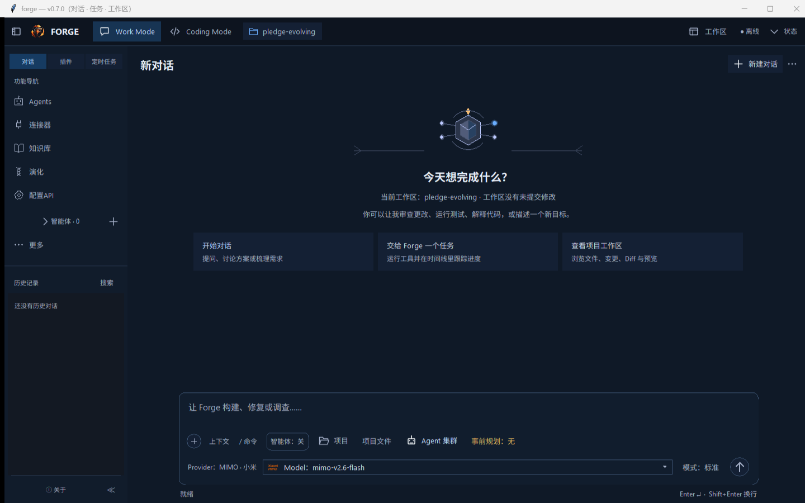
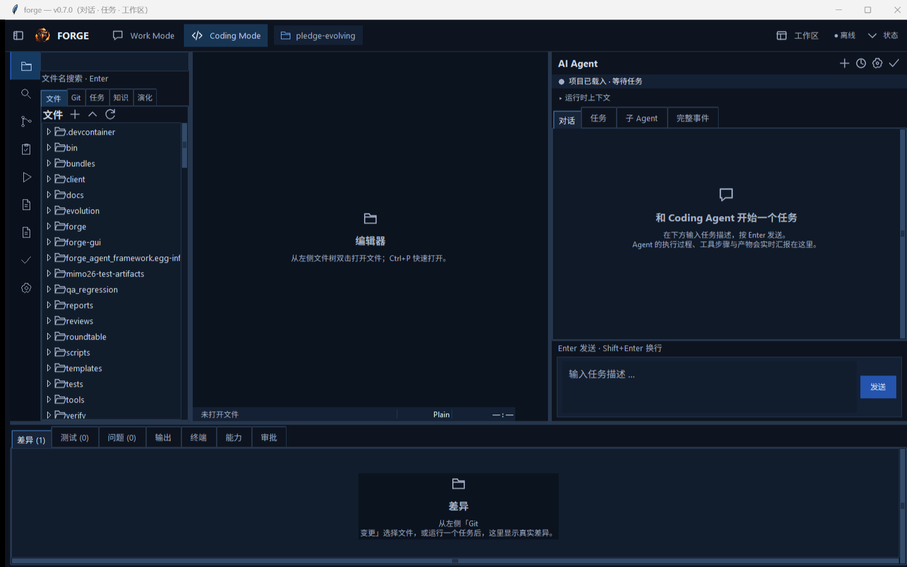
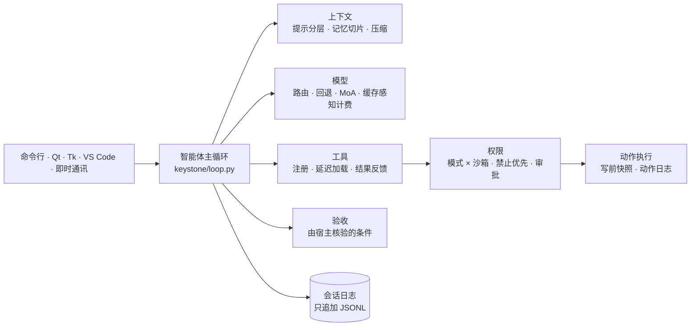

# Pledge Keystone

**装在你自己电脑上的 AI 助手：能真正动手干活，也守得住它对安全的每一条承诺。**

[](https://www.python.org/)
[](.)
[](.)
[](LICENSE)

[English](README.md) · **中文**

---

## 一分钟看懂

大多数 AI 聊天软件只会"说"。Pledge Keystone 还会"做"：读写文件、运行检查、上网搜索、操作你指定的窗口，还能把任务分给几个小助手。它做事时守着你定的规矩：

- **有风险的事先问你。** 每个动作都要过权限检查；只要有一条"禁止"规则，就一定拦下。
- **改错了能撤回。** 已启用工作区检查点时，受管写入会先保存可回退的文件版本。
- **密钥不外泄。** API 密钥放在单独的保险箱里，不写进配置文件；日志和回复里一律打码。
- **做完自己验收。** 你可以附上一份验收条件（比如"测试全部通过""某个文件里有某段内容"），由电脑而不是模型来确认，满足了才算完成。
- **替你省钱。** 在便宜的模型和更强的模型之间自动挑选，复用缓存，每次跑完告诉你花了多少。

同一个助手可以在多个地方用：桌面应用、VS Code、命令行、微信、安卓手机。



## 马上试试

| 你的环境 | 这样做 |
| --- | --- |
| **Windows** | Code → Download ZIP → 解压 → 双击 **`setup.cmd`**。没有 Python 会自动装上，然后建好桌面快捷方式并打开应用。 |
| **macOS / Linux** | 运行 `bash setup.sh qt` 打开共用的 Qt 桌面（Python 3.11–3.14），或运行 `bash setup.sh` 使用经典启动方式。 |
| **任何装了 Python 3.10+ 的机器** | `python run.py selftest`：对真实内核跑完整的离线检查，不需要密钥，也不联网。 |

接入模型：运行 `python run.py setup`（几步问答的向导），或者在应用欢迎页按引导填写。

## 名字的由来

**Keystone（拱心石）** 是拱门顶端正中的那块楔形石：有了它，两边的石头才互相锁住、立得起来。这正是本项目要做的事：用一个小而稳的内核，把模型、工具、权限、记忆和各个使用入口锁成一个整体。**Pledge（承诺）** 是它守的诺言：合同、权限规则和验收条件都可以被检验，而不只是寄希望于模型自觉。

项目以前同时叫 *Forge* 和 *pledge-evolving*，现在统一为 Pledge Keystone。已有安装依赖的一切都照常可用（见[从 Forge 迁移](#从-forge-迁移)）。

---

## 开发者部分

下面是工程视角：内核是什么、怎么搭起来的、怎么验证。

### 它是什么

一个**完全只用 Python 标准库写成**、按生产要求设计的智能体内核，上面接了多个前端：

| 入口 | 启动方式 | 说明 | 支持级别 |
| --- | --- | --- | --- |
| 命令行 | `python run.py <命令>` | 脚本、CI、无人值守任务。`run.py` 是通用入口；标准 Python 下 `python -m keystone.cli` 也能用。 | 主力 |
| 桌面（Qt） | Windows 首次运行 `keystone-gui/desktop/install-qt.ps1`，随后使用 `keystone-gui/Keystone Qt.cmd`。macOS / Linux 运行 `bash setup.sh qt`。 | 主力聊天客户端，支持 Work 模式、模型配置引导、命令面板和审批卡片。各系统使用独立的 Qt 环境。 | 主力 |
| 桌面（Tk）+ Coding 模式 | `python keystone-gui/keystone_gui_v2.py` | 三栏 IDE：文件树与 Git、多标签编辑器、Agent 面板、diff/测试/问题面板。 | 实验性 |
| VS Code | `vscode-extension/` | 侧边栏对话、解释/审查选中代码，走本地 JSONL 桥。 | 实验性 |
| 即时通讯 | `python run.py channel weixin serve` | 收到一条消息就生成一个任务，任务报告再作为消息发回。 | 实验性 |
| 安卓 | Release 里的 APK `forge-android-v0.4` | 仓库里是旧副本，开发已迁到独立仓库 `pledge-steward`。 | 实验性 |

CLI 和 Qt 桌面是主力入口。实验性入口可能只覆盖部分功能，各次发布的测试范围也可能不同。Qt 在 macOS 和 Linux 上有启动脚本，本次桌面回归覆盖 Windows。



### 架构



每个决定都写进 `sessions/*.jsonl`（`user_message`、`tool_call`、`subagent_spawn`、`compaction`、`checkpoint`、`assistant_message` 等）。日志是事实来源；索引只是缓存，`sessions --rebuild` 随时可以重建。

### 内核能力

| 方面 | 实际做了什么 | 可用入口 |
| --- | --- | --- |
| **项目验证** | `run_check` 运行项目中已识别的测试、Lint 或构建任务。每次执行前都要确认命令、目录和超时，包括完全访问档。 | 交互式 CLI、Qt Work 和 Coding |
| **看图** | `view_image` 把工作区中的 PNG 或 JPEG 发给支持图片输入的模型。Chat 可以查看当前对话生成的图片附件。自定义接口实测支持图片输入后，可以在路由或模型能力里声明 `vision: true`。 | CLI、Qt Coding、Work 和 Chat |
| **办公页面和 PDF** | `office_render` 将已保存的文档页或幻灯片渲染成 PNG 附件，供视觉模型查看。`read_pdf` 按页提取 PDF 自带的文字。 | Qt Work |
| **主循环** | 提示分层且有上限；压缩时保留尾部，并感知前缀缓存。步数预算：剩余回合提示只附在当次请求、不写入历史；步数用完后给出一段不调工具的进度小结。格式错误只按连续次数计，出错的回合退还步数；验收返工至少保留 3 回合；模型请求重试每步至多一次、整个运行至多 3 次，并参考 `Retry-After`。 | CLI、Qt Coding |
| **工具** | 工具注册，按需通过 `tool_search` 延迟加载。**结果反馈**帮模型省回合：写入后在同一条结果里解析 `.py`/`.json`/`.toml`、标出冲突标记；路径不存在时给出"是不是要找"的建议；宿主整体拒绝的工具在本次运行里直接熔断，并给出一次替代工具说明。 | CLI、Qt Coding、Work 工具网关 |
| **防打转** | 检测并终止重复的"动作—结果"循环；同一工具连发时给提示；工具结果未知时停下，不自动重放。 | CLI、Qt Coding |
| **权限** | 二维权限（模式 × 沙箱档位）加命令黑名单；**禁止规则永远优先**；子智能体不得超过父级上限；启用检查点时，受管写入先用影子 Git 保存工作区快照。 | 所有内核调用入口 |
| **密钥** | 独立的保险箱和作用域：提示词里只放替身，事件和结果里打码，工具读不到保险箱。 | 所有内核调用入口 |
| **验收** | `keystone run 任务 --acceptance 条件.json`：文件、命令、环境探针等条件由宿主核验，模型改不了检查本身。 | CLI run |
| **模型路由** | 经济 / 均衡 / 高端三档；按错误类型触发回退；MoA 聚合；高端两段式（起草→裁定），失败时退回已付费的草稿。 | CLI、Qt、网关 |
| **成本与缓存** | 按请求计价；子智能体花费并入父账本；跨厂商记录缓存温度；缓存热时推迟压缩。 | CLI、Qt Coding |
| **记忆** | 分类长期记忆、双写；整理器只归档不删除；注入量始终有上限。 | 内核 Agent |
| **协议** | 本地网关双向翻译 Anthropic ↔ OpenAI（Chat 与 Responses），包括 SSE 流和工具调用增量。 | 本机网关 |
| **编排** | 零依赖的图运行时：带归约器的状态通道、超步循环、中断/恢复、检查点、主管/工人模式。 | CLI、Python API |
| **自我演进** | 信号 → 候选 → 闸门 → 账本 → 回滚；长期目标永远需要人点头，任何配置都绕不过去。 | CLI |
| **操作电脑** | 由宿主绑定窗口，截图不出本机（模型只看到摘要）；观察/操作走同一条权限链；坐标点击绑定截图并逐点确认。 | Qt「电脑操作」页，需先选择窗口并授权 |

子任务分派需要正在运行的父 Agent 提供预算、取消信号和权限上限。CLI 和 Qt Coding 的内核运行可提供这些能力。独立工具网关和桌面 Work 工具连接没有父 Agent。Work 中配置的团队协作有独立入口。

### 工程原则

1. **内核零依赖。** 内核只用标准库；可选扩展（YAML、Qt）不进内核。
2. **默认可验证。** `python run.py selftest` 是离线的端到端证明，其余由单元测试覆盖。
3. **事实只追加写入。** 会话、动作、成本都可以重建；被打断的动作绝不自动重放。
4. **仓库里的文字不授予任何权限。** `AGENTS.md`、工具输出、网页内容都只是数据，不会被当成许可。
5. **贡献要过合同闸门。** `keystone/contrib/` 里的模块由七个不同的 AI 智能体按冻结的 [`contract.md`](contract.md) 编写；`keystone/registry.py` 先做静态 AST 扫描（禁止网络、子进程、破坏性文件操作和 `eval`），再隔离导入，并要求模块自带至少八项自检全部通过，才予以接纳。

### 配置

配置是一个空根加有序的补丁层：`keystone/bundles/*.json` → 模式包（如 `modes/coding.json`）→ 用户层 `~/.keystone/keystone.patch.json` → `--overlay` 文件，同一行 id 以最后写入为准。`python run.py dump-config` 查看合成结果；`dump-default-config` 跳过用户层，所以用户配置写坏了也不会把你锁在门外。

步数相关配置在一个地方统一解析，所有入口共用（`keystone/loop_limits.py`）：

| 键（`loop` 行） | 默认值 | 含义 |
| --- | --- | --- |
| `maxSteps` | 12（coding 模式 40） | 每次运行的模型回合数。优先级：单次请求参数 > 用户层 > 厂商 `steps_hint` > bundle |
| `maxDepth` / `spawnBudget` | 2 / 8 | 子智能体层数，以及一次运行最多派出几个子智能体 |
| `wrapUpOnLimit` | `true` | 剩余回合提示与触顶进度小结（`maxSteps` 小于 6 时不启用） |
| `contextChars` | 24000 | 压缩预算，会再按厂商画像调整 |

**角色模板**：不想从零配置时，可以直接选一个预设角色——全栈开发师、建模设计师、学习助手、智能管家、写作助手、代码审查员、信息调研师。每个角色是 `keystone/bundles/agents/<id>.json` 里的一份数据：角色指引、可用工具、权限与沙箱、步数预算、规划档位、偏好技能和起手提示。命令行用 `python run.py run --template reviewer "审查当前改动"`，`python run.py templates` 列出全部，`templates duplicate <id>` 复制到 `~/.keystone/agents/` 后自行修改；桌面版在新对话页和输入框旁切换。角色只会在你自己的权限之内再收窄：它叠加在用户层和 `--profile` 之后，拒绝和询问规则永远优先，也不能放宽沙箱、读取范围或你在用户层写下的步数（`keystone/agent_templates.py`）。

密钥来自环境变量（`KEYSTONE_<名字>_KEY`）或密钥保险箱，从不写在配置里；`doctor` 发现配置里直接写了 `apiKey` 会报警告。

### 从 Forge 迁移

不移动、不改写磁盘上的任何东西；只有在新名字还不存在时才去读旧名字：

| 以前 | 现在 | 兼容方式 |
| --- | --- | --- |
| `~/.forge/` | `~/.keystone/` | 没有 `~/.keystone` 时继续用已有的 `~/.forge`；设置 `KEYSTONE_HOME`（或旧的 `FORGE_HOME`）可以指定位置 |
| `forge.patch.json`、`forge-desktop.json` | `keystone.patch.json`、`keystone-desktop.json` | 新文件出现之前，原地读写旧文件 |
| `FORGE_*` 环境变量 | `KEYSTONE_*` | 导入时双向互为别名，旧配置里的 `env.FORGE_*` 表达式照常解析 |
| `forge-plugin.json`、`forge.capability.json`、`<项目>/.forge/` | `keystone-plugin.json`、`keystone.capability.json`、`<项目>/.keystone/` | 两种名字都能识别，也都受保护 |
| `forge` 命令、`bin/forge.cmd` | `keystone`、`bin/keystone.cmd` | `forge` 保留为别名 |
| `import forge` | `import keystone` | 不提供垫片；仓库内的调用方已全部更新 |

保持不变的有：安卓应用 ID（`com.forge.android`，已装的手机应用能继续升级）；以及归档的报告和记录（`reports/`、`roundtable/`、`evolution/`、`reviews/` 等），保留当时的原文。

### 目录结构

| 位置 | 内容 |
| --- | --- |
| `keystone/`、`keystone-gui/` | Agent 内核和桌面客户端 |
| `tests/`、`verify/` | 集成测试和独立核验脚本 |
| [设计取舍](docs/design.md)、[项目历史](docs/history/) | 架构决策、早期计划和贡献任务书 |
| [模块契约](contract.md) | 现行贡献接口与准入规则 |

```
pledge-keystone/
├── keystone/              内核（只用标准库）
│   ├── loop.py            主循环：步数、重试、预算、验收
│   ├── loop_limits.py     maxSteps / 层数 / 子智能体预算的统一解析
│   ├── tools.py           工具注册与内置工具
│   ├── tool_feedback.py   写入后检查、路径建议、工具熔断
│   ├── policy.py          权限：模式 × 沙箱，禁止优先
│   ├── secrets.py         密钥作用域、打码、保险箱边界
│   ├── model.py routing.py vendors.py adapters.py   模型、路由、厂商画像
│   ├── gateway.py wire.py openai_responses.py      协议网关与翻译
│   ├── session.py checkpoint.py memory.py          事件日志、快照、记忆
│   ├── acceptance.py probes.py                     宿主核验的验收
│   ├── graph/ scienceclaw/ channels/ development/ contrib/
│   ├── compat.py          Forge → Keystone 兼容（目录、文件、环境变量）
│   └── selftest.py cli.py
├── keystone-gui/          桌面端：Qt 前端（qt_frontend/）、Tk 外壳 + Coding 模式
├── vscode-extension/      VS Code 侧边栏扩展
├── client/                本地网页客户端与运行服务
├── forge-android/         安卓旧副本（现在在 pledge-steward 开发）
├── tests/                 跨模块集成测试
├── bundles/ templates/ scripts/ docs/
└── run.py setup.cmd setup.sh
```

### 测试

```bash
python run.py selftest                                         # 离线端到端检查
python -m unittest discover -s keystone -p "test_*.py" -t .    # 内核单元测试
python -m pytest -q tests/                                     # 集成测试
# Qt 前端（需要 .venv/qt）：
cd keystone-gui && ../.venv/qt/Scripts/python -m unittest qt_frontend.test_backend
```

运行界面测试时设置 `KEYSTONE_NO_AUTOSTART=1`，避免启动真实网关。

### 已知限制

- 文件读取工具按 `readScope` 检查解析后的路径。选 `auto` 时，只读和工作区可写沙箱都只读工作区，完全访问则可读当前账户可访问的路径。选 `workspace` 时，可读工作区和显式添加的读根。选 `all` 时，路径检查允许读取工作区外的文件。宿主的密钥保护仍然生效。[路径策略](keystone/policy.py)
- 普通 CLI 任务默认采用均衡档，读取范围为工作区。命令行的 `--read-scope` 优先于配置，配置优先于档位默认值。桌面“沙箱运行”只读当前工作区。“手动批准”和“完全访问”均允许跨目录读取，前者按操作审批。使用角色模板时，实际授权还可能收窄。[CLI 档位](keystone/cli.py) · [桌面授权](keystone/desktop_permissions.py)
- 上述控制发生在 Keystone 进程内。获准执行的 shell 命令或 MCP 服务可访问其进程和凭据有权访问的资源。显式 `allow` 可以放宽模式默认的询问或拒绝。显式拒绝规则、已分类写工具的只读限制和路径检查优先。[策略判定](keystone/policy.py)
- 通用 HTTP 传输逐请求建立连接。火山方舟 Seed 网关可在连续工具轮次间复用空闲的 HTTPS 连接。[通用传输](keystone/http_transport.py) · [Seed 传输](keystone/seed_transport.py)
- 能力包安装会记录来源，目前没有发布者签名校验。记忆召回按类别和有效状态筛选，优先返回置顶记录，再按创建时间倒序排列，目前没有向量检索。[能力包安装](keystone/capability.py) · [记忆召回](keystone/memory.py)
- 高端两段式会把任务和草稿（不是完整对话历史）发给裁定档模型。

### 后续工程计划

- 为通用 HTTP 传输按主机复用连接，覆盖超时与重试的交互。
- 为能力包安装增加发布者签名校验，为记忆检索增加向量召回。
- 用脱敏的真实响应回放测试 HTTP、SSE 流解析和厂商协议转换。

### 项目状态

首次提交于 2026-09-17，仍在密集开发，目前一名维护者。`contract.md` 冻结的是模块边界，公开 API 还未冻结。之所以公开，是因为这套设计和贡献闸门值得阅读和复用。

MIT 许可。项目结构图：[中文](docs/project-tree.zh.png) · [English](docs/project-tree.en.png)。
