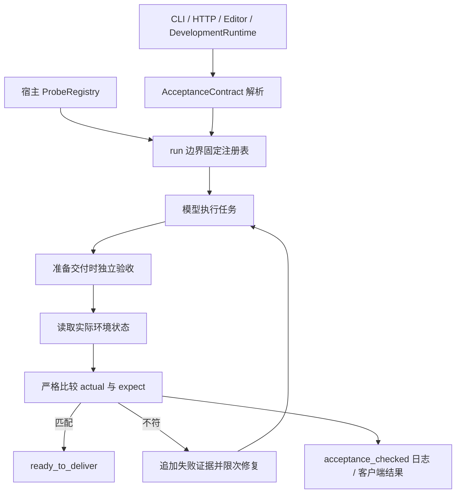

# 环境探针：由宿主独立验收任务状态

本轮目标是让声明了环境条件的任务，在模型交付前取得真实观察值并验收。检查范围仍由显式契约决定，不能据此声称任意自然语言任务都已被完整证明。

## 本机源码对照

| 参考 | 实际读取的源码与取舍 |
| --- | --- |
| Loom（`Documents/ChatGPT/Codex/loom`，HEAD `2c8f755`） | `packages/kernel/src/verifier.ts` 的 env_probe：环境暴露观察函数，内核读取并严格比较实际值与期望值。移植其职责边界，增加输入参数和宿主注册快照 |
| SWE-agent（`Desktop/开发/SWE-agent`，HEAD `3ea751c`） | `sweagent/run/hooks/swe_bench_evaluate.py`：结果提交与外部评测分别处理，不把模型的 submission / exit_status 当成通过评测。吸收独立验收纪律，没有移植 sb-cli、网络提交或容器依赖 |
| LangGraph（`Desktop/本地工作流/langgraph` 本地源码快照，无 Git 元数据） | `libs/langgraph/langgraph/pregel/_read.py` 的 ChannelRead.do_read：读取来自宿主绑定的函数，未配置即失败，并区分 fresh 读取。Forge 用固定注册表、每次重新观察实现，不导入 Runnable / LangChain |

## 新能力与实现

`forge/probes.py` 是独立观察层，`forge/acceptance.py` 继续负责契约语法和聚合结果，`Agent` 继续负责验收/修复/停止生命周期。原本 file / command 检查保持兼容；本轮也把检查类型的允许字段收口成一份表，防止解析与序列化字段漂移。

新增 `env_probe` 契约：

```json
{
  "max_attempts": 3,
  "criteria": [{
    "id": "ready-state",
    "kind": "env_probe",
    "env": "workspace",
    "probe": "json_value",
    "input": {"path": "result.json", "pointer": "/ready"},
    "expect": true,
    "timeout": 5
  }]
}
```

CLI 可直接使用：

```powershell
python run.py run "生成 result.json 并将 ready 设为 true" --acceptance templates/acceptance.probes.example.json --json
```

两个默认探针无需自定义 Python 或开启 shell：

| 探针 | 输入 | 实际值 |
| --- | --- | --- |
| `workspace.json_value` | `path`、可选 `pointer`（缺省为空，表示整个 JSON） | 从真实文件读取并按 JSON Pointer 取值；支持数组及 `~0` / `~1` 转义 |
| `workspace.file_digest` | `path` | 原始文件字节的 SHA-256，保留 BOM、换行差异；`expect` 填期望摘要字符串 |

默认探针的读取经过现有 `read_file` 授权和公共文件边界；路径限制在工作区，符号链接不得越界。JSON 字段是在现有 SecretScope 保护后的文本上读取，受保护配置秘密不会作为明文观察值回传。摘要探针只返回摘要，不返回文件正文。

缺失文件/字段、重复 JSON 键、NaN/Infinity、无效数组索引和非 JSON 回执都不能通过。比较按规范化 JSON 文本进行，键顺序不影响结果，但 `true`、`1`、`1.0`、`"true"` 不会被混为相等。输入和期望值必须是有限 JSON；嵌套最多 16 层，单值序列化最多 32768 字符。

## 宿主注册真正的环境状态

```python
from forge.probes import ProbeRegistry
from forge.assembly import build_agent

def observe_application(ctx, request):
    ctx.check_cancel()
    # 该对象由宿主持有，读取实际应用状态，不读取模型自述。
    return {"saved": application.has_saved_document()}

probes = ProbeRegistry.defaults().with_probe(
    "application", "document_state", observe_application)
agent = build_agent(home=home, workspace=workspace, config=config,
                    router=router, probes=probes)
report = agent.run("完成保存", acceptance={
    "criteria": [{"id": "saved", "kind": "env_probe", "env": "application",
                  "probe": "document_state", "input": {}, "expect": {"saved": True}}]
})
```

注册表不可变，重复名字拒绝；`.with_probe()` 返回新表。Agent 在 run 边界固定注册表，未知探针或默认探针的非法输入在模型调用前报错，运行中替换 Agent.probes 不能放宽当前检查。函数对象从不进入契约 JSON、提示词或日志，模型没有注册探针的工具。

宿主扩展入口均为 Python 参数：

- `Agent(..., probes=...)` / `forge.assembly.build_agent(..., probes=...)`，旧 `forge.loop.build_agent` 兼容入口也支持。
- `EditorBridge(..., probes=...)` / `DevelopmentRuntime(..., probes=...)`；开发模式重建自有桥时保留注册表。借用现有 bridge 时应在原宿主处配置，不隐式更改共享 Agent。
- `ClientServer(..., probes=...)` / `run_forge(..., probes=...)`；HTTP 客户端只提交契约中的名字、输入和期望值，不能提交实现。

自定义观察函数属于可信宿主代码，必须自行遵守环境授权、只读和线程约束。回调只收到工作区、run_id、截止时间、取消信号与受控读取方法，不收到 Agent、模型历史或工具注册表。此接口不是对任意 Python 函数的安全沙箱。

## 实际调用链与失败语义



命令检查先执行，文件和探针检查在后，避免某个后置命令改坏已验收状态。每次尝试都重新观察，不复用上一轮 passed。失败回填证据标为 untrusted；必选项不全通过，任务不能 final。

每个探针上限 1–60 秒。观察运行在受限数量的 daemon worker 中，主运行保持取消响应；超时不能产生 passed，也不自动重放尚未结束的观察。相同工作区/探针仍在运行时拒绝再次调用，全宿主最多 32 个在途观察。主机无法强制终止一个不协作的 Python 线程，因此回调应使用自身有界 I/O 并定期 `ctx.check_cancel()`；超时/取消后迟到的回执不会提交成功。探针失败不会伪造对外动作已经完成。

证据包括 actual、expect、探针名、状态以及默认文件观察的字节摘要。它经过现有秘密保护后进入 `acceptance_checked`、修复反馈、`run_payload` 和客户端持久化结果。一次观察仅证明该时刻的声明条件；配置文件 ready=true 不自动证明服务已部署，服务状态应由真正的宿主服务探针检查。

## 验证与边界

新增 15 项内核专项，覆盖虚报完成、真实工具修复后重新观察、严格类型、JSON Pointer、原始字节摘要、权限拒绝、无效契约、未知探针、宿主注册、异常回执、运行时换表、超时/忙碌、取消与证据脱敏。

新增 5 项入口测试，使用真实本地 CLI/HTTP/Editor/DevelopmentRuntime 和离线模型，验证默认探针失败/成功、客户端结果、HTTP 自定义宿主探针，以及开发模式装配时的注册表传递。

最终验证：

| 检查 | 结果 |
| --- | --- |
| 新增探针内核专项 | 15/15，通过；计入内核回归 |
| 新增 CLI / HTTP / Editor / DevelopmentRuntime 入口专项 | 5/5，通过；计入运行时回归 |
| 内核完整回归 | 384 项，382 通过、2 跳过 |
| 运行时、客户端和开发模式 12 组回归 | 203 项，202 通过、1 跳过 |
| 框架自检 | 595/595 |
| 代码行数预算 / Git 空白检查 | 143 个文件通过；接受 Windows CRLF 的空白检查通过 |

内核与运行时合计 **584 项通过、3 项跳过、0 失败**。未重复计入新增专项；未做真实云模型评测或 GUI 视觉验收。日志：`reports/loom-probe-targeted.log`、`reports/loom-probe-entries.log`、`reports/loom-probe-core.log`、`reports/loom-probe-runtime.log`、`reports/loom-probe-selftest.log`。

快照见 `reports/loom-probe-backup.txt`，本轮补丁见 `reports/loom-probe.patch`。保留既有未提交工作，没有修改参考仓库、开放默认 shell、调用真实云模型、修改凭据或提交 Git。
