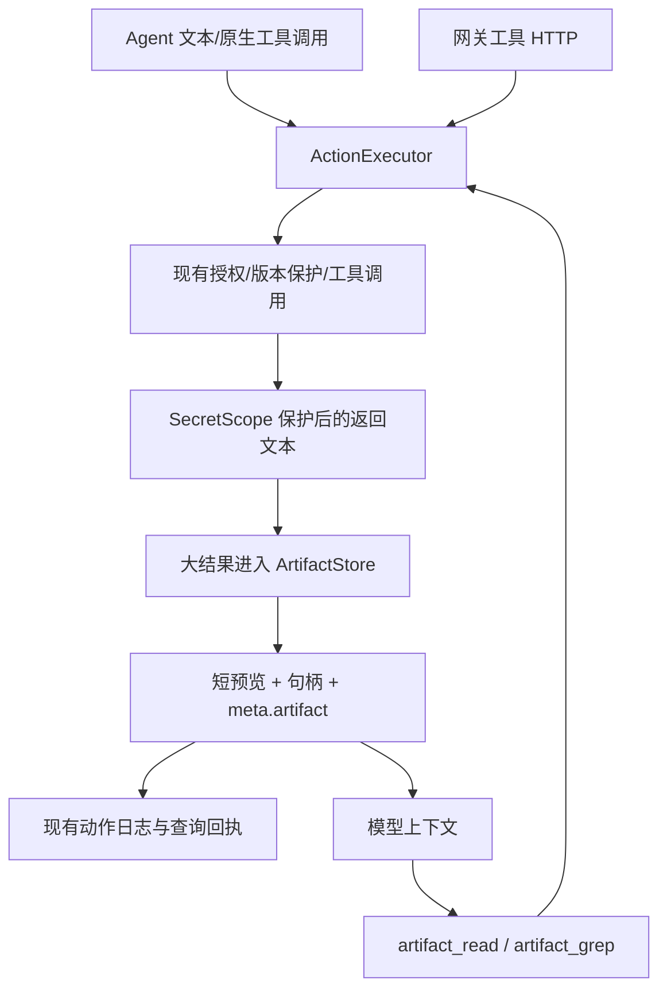

# Loom / Codex 源码对照：补齐长结果留存与按需读取

## 选题依据

本轮继续读取本机 Loom（`Documents/ChatGPT/Codex/loom`，HEAD `2c8f755`）和 Codex（`Desktop/开发/codex`，HEAD `67f0994`）源码。它们只作为参考，未修改。没有把本机所有框架都视为已经完成审查。

| 尚未集成的设计 | Forge 当前缺口 | 本轮选择 |
| --- | --- | --- |
| 内容寻址 artifact + 分页/搜索 | 旧 ScienceClaw 外置器自动写 `workspace/research_data`；随机文件名无法去重；摘要建议用 `read_file`，但该工具本身有预览上限；工具轮次还可能再次截断结果 | 优先实现：直接改善长任务可用性，并消除运行时对用户工作区的隐式写入 |
| 事件 DAG 与分支工作区恢复 | 线性 fork 复制日志，不能等同于回滚文件 | 需同时处理分支所有权、未提交文件和多个入口，未在本轮改存储 |
| 动态效果/资源调度 | 已统一工具执行，但仍按顺序执行；shell/MCP/电脑操作尚无统一资源集合 | 不能仅为并行增加调度函数，后续应先规范宿主效果与资源边界 |
| 信息流来源标签与对外发送确认 | 检索内容与对外动作缺少贯通权限卡片的来源判定 | 本轮保留 artifact 的来源与 untrusted 标签，未宣称完成全局信息流防护 |
| 环境探针验收 | 当前文件验收可运行，受保护 Agent 的原生命令验收仍受隔离约束 | 适合后续用宿主注册的只读环境探针补齐，不能借此开启任意 shell |

具体参考：

- Loom `packages/kernel/src/artifacts.ts`：SHA-256 内容句柄、来源合并、完整内容与预览分离、分页和字面量搜索。
- Loom `packages/kernel/src/kernel.ts:619` / `:640` / `:734`：内置 artifact 读取/搜索工具，大输出转引用。
- Codex `codex-rs/core/src/tools/context.rs:428`、`:570`：留存输出和模型可见截断分别处理，并为元数据/提示预留输出预算，避免二次截断。
- Forge `forge/scienceclaw/offload.py`：原有阈值和独立嵌入 API 保留，运行时改接新的宿主存储；重复的 wrap / wrap_result_text 写入逻辑合并。

语言与边界不同，因此按设计重新实现 Python 标准库版本，没有引入 Rust/Node 运行时或第三方依赖。

## 实际实现

`forge/artifacts.py` 提供宿主存储：

- 句柄为 `a_<SHA-256>`；内容相同只保存一份，合并最多 64 条来源记录。
- 路径为 `<Forge home>/artifacts/<workspace fingerprint>/`，不再自动写 `research_data`。通常 home 在工作区外；若宿主刻意把 home 放进工作区，物理位置仍由该宿主配置决定。
- 内容先落临时文件、flush/fsync，再原子替换；元数据是完成标记。按对象锁串行化写入，读取校验摘要和字节/字符长度。
- 以实际工作区分区，句柄不能作为任意路径；拒绝越界、非法句柄和重定向的存储路径。原始文件工具也不能覆盖受保护的 host artifacts。
- 单项最多 8 MiB；不自动删除已有证据。超限、磁盘故障或损坏不会冒充保存成功。
- 保存已经过现有 SecretScope 保护的工具返回文本，统一标记为 untrusted；来源记录包括工具名和 action_id。来源标签是数据描述，不是执行授权。

`forge/artifact_tools.py` 注册两个现有权限链内的只读工具：

```json
{"tool":"artifact_read","args":{"id":"a_<64位摘要>","offset":0,"limit":2000}}
```

`offset` 是从 0 开始的 Unicode 字符偏移。模型根据 `next_offset` 继续读取，即使结果只有一条超长行也不会卡在相同行范围。

```json
{"tool":"artifact_grep","args":{"id":"a_<64位摘要>","pattern":"目标字符串","offset":0,"limit":10}}
```

搜索为字面量搜索，返回字符位置、短预览及下一页偏移，不执行正则或内容。两工具都限制返回大小，给页头预留预算，而且不会再次被外置成嵌套 artifact。

## 接入与失败语义



- 保存在共同动作执行边界，Agent 与网关都生效；动作查询回执和客户端 Step 元数据携带相同句柄。
- Agent 的现有 Offloader 接入同一存储；有完整 artifact 的结果不再重复外置。旧独立嵌入 API 未指定 artifact_store 时保留原行为。
- 编码模式仓库版与打包版的工具 expose / allow 同步加入两个读取工具。用户明确的 expose、hide 或 deny 仍优先，未自动绕过自定义工具限制。
- 存储失败保留原动作的成功/失败/未知状态，记录 `artifact_retention.status=failed`；给模型的预览明确提示保存失败、可能不完整，不自动重跑动作或回退到工作区写文件。
- 留存对象是工具实际返回的受保护文本。若具体工具在返回前已截断上游数据，artifact 无法恢复那部分数据，也不会声称保存了未收到的内容。
- 既有厂商请求、上下文压缩和计费逻辑不变；新增工具会改变初始工具面，轮次之间仍只追加结果。

## 验证

新增 `forge/test_artifacts.py` 的 14 项测试，覆盖去重/来源、Unicode 单行分页、字面量搜索续页、非法参数、跨工作区隔离、损坏和未完成写入、超限、脱敏、存储失败后的动作去重、已知失败语义、deny、有限读取、真实 Agent 搜索并读取预览之外的尾部、编码模式暴露和失败时不回退工作区。

新增 `tests/test_artifact_gateway.py` 的 2 项测试，通过真正的本地 HTTP 验证只读网关的大结果保存、动作回执查询、分页/搜索，以及宿主 artifact 不可被原始写工具覆盖。

最终验证：

| 验证 | 结果 |
| --- | --- |
| 内核完整回归 | 369 项：367 通过、2 跳过 |
| 运行时、客户端、开发模式与网关 11 组回归 | 198 项：197 通过、1 跳过 |
| 框架自检 | 595/595 |
| 旧 ScienceClaw 离线兼容自检 | 32/32 |
| 代码行数预算 / Git 空白检查 | 141 个源码文件通过；接受 Windows CRLF 的空白检查通过 |

内核与运行时合计 **564 项通过、3 项跳过、0 失败**。新增专项是回归总数的子集，不重复计数。日志前缀为 `reports/loom-artifact-*`。没有进行真实云模型性能评测或 GUI 视觉验收。

本轮前快照路径见 `reports/loom-artifact-backup.txt`；独立补丁为 `reports/loom-artifact.patch`。保留既有未提交工作；未提交 Git、发布、调用真实云端模型或修改凭据。
