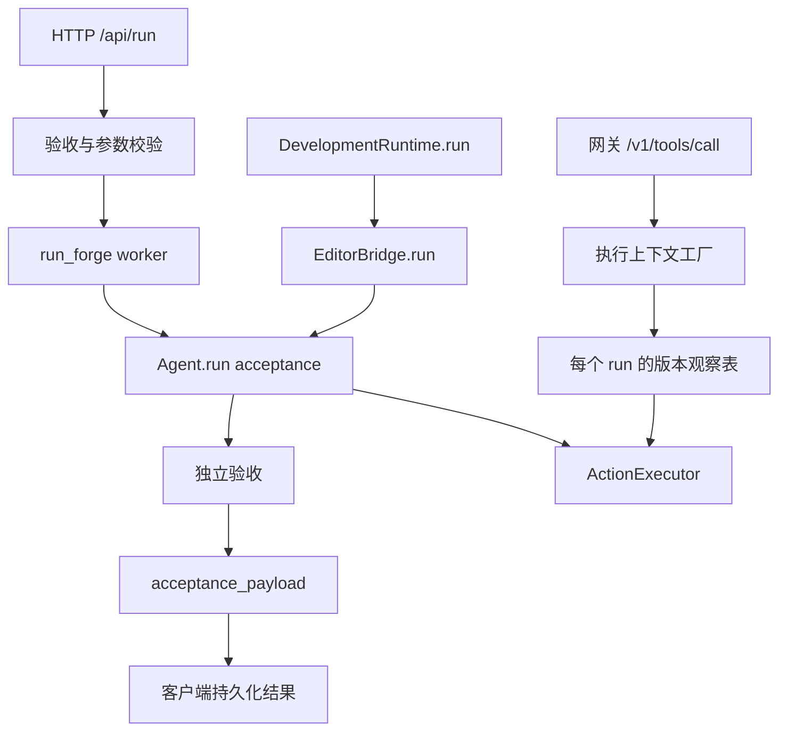

# 重构后实际调用链复核

本轮在前两轮现有工作区上继续检查；快照见 `reports/loom-chain-backup.txt`。

## 发现并修复的问题

| 问题 | 触发条件与影响 | 修复 |
| --- | --- | --- |
| 网关缺少默认版本保护 | Agent 构造时已接入 guard，但网关直接调用 `create_execution_context()`，默认 `file_guard=None`；同一 run 读完文件后，外部编辑仍可能被后续写入覆盖 | 将默认观察型 guard 补到执行上下文工厂；网关缓存的上下文持有同一观察表，不同 run 分离；宿主传入的严格 guard 原样保留 |
| HTTP 验收契约被忽略 | `/api/run` 载荷允许附加字段，但 worker 没有把 acceptance 传给 Agent；可能在用户以为有验收时直接成功 | HTTP 入站先校验，再传给 worker 和 Agent；结果回写客户端持久化记录，重载仍可看到失败证据 |
| 编辑器和开发模式遗漏契约入口 | `EditorBridge.run()`、`DevelopmentRuntime.run()` 未转发验收参数 | 补充可选 `acceptance`，编辑器在改策略、发用户事件、改历史之前校验；开发模式也先校验再启动任务 |
| 无法显式关闭子代理 | 客户端范围校验拒绝 0；worker 使用 `value or default` 会把 0 替换成默认值 | 深度和数量允许 0，步数仍至少 1；只用 `None` 表示缺省 |
| 并发版本冲突丢失错误分类 | 两个请求带相同旧版本并发写入时，默认 guard 正确拒绝后者，但异常被统一映射为 `preparation_failed` | 增加宿主侧 `FileRevisionConflict`，在派发前保留 `revision_conflict` 与 `not_started`；不改变已派发异常的 unknown 语义 |
| 公共类型仍耦合执行系统 | 导入 `runtime_types` 立即导入 `execution`，进而拉入工具系统；`tool_turn` 仅为类型注解导入厂商协议模块 | 结果转换按需导入；工具协议类型只在 `TYPE_CHECKING` 下导入。新进程验证导入这两个模块不会加载 execution/tools/toolwire |
| 重复投影和重复导入 | 客户端如复用整个 `run_payload()` 提取验收，会重复转换 RunResult、计算缓存指标；装配层重复导入 Session | 提出 `acceptance_payload()` 供完整协议和 HTTP 客户端共用；Session 保持一个导入和创建位置 |

## 现在实际走的路径

普通 Agent 仍拥有跨工具调用的观察表并传入上下文工厂，不能每次调用都重新创建空表；网关持有缓存上下文，观察表随该 run 保持。新 run 不继承旧表。重新读取会刷新观察，之后才允许按新版本修改。执行器仍进行原有授权、取消和审计。

验收契约是当前 run 的显式输入。新增的是 HTTP/RPC/Python API 接入，没有新增 GUI 契约编辑控件；默认 shell 隔离和拒绝规则仍适用于命令验收。

## 验证

新增 `tests/test_chain_integration.py` 的 8 项测试，不调用真实模型：

- 真正的 HTTP 请求：非法契约在创建任务前返回 400；契约不满足时任务进入 error 而非 done，失败证据重载后仍存在。
- 真正的 HTTP worker 与 Agent：契约满足时成功，显式零子代理限制进入 Agent。
- 真正的网关 HTTP 动作：读取→外部修改→写入被拒绝；不同 run 观察表分离；重新读取后可以按新状态写入。
- 真正的开发模式→编辑器→Agent：验收失败阻止成功；非法契约不改变编辑器历史或请求模型。
- 独立 Python 进程：公共类型和工具轮次模块导入不加载执行器、工具注册表或厂商协议模块。

完整回归额外覆盖原有“同一版本并发写入只能一方成功”用例；该用例发现上述错误分类问题，已修复并重新运行相关回归。日志：`reports/loom-chain-targeted.log`、`reports/loom-chain-concurrency.log`、`reports/loom-chain-core.log`、`reports/loom-chain-runtime.log`、`reports/loom-chain-selftest.log`。

修复后的最终结果：

| 验证 | 结果 |
| --- | --- |
| 新增入口链路测试 | 8/8 通过 |
| 并发及运行时一致性专项 | 62/62 通过 |
| 内核完整回归 | 355 项，353 通过、2 跳过 |
| 运行时/客户端/开发模式 10 组回归 | 196 项，195 通过、1 跳过 |
| 框架自检 | 595/595 通过 |
| 代码行数预算清单 | 138 个文件通过 |
| Git 空白检查 | 接受 Windows CRLF 的配置下通过 |

内核与运行时合计 **548 项通过、3 项跳过、0 失败**；专项数字是上述回归的子集，不重复计入总数。验证使用离线模型和本地 HTTP/文件系统，没有进行真实云模型评测或 GUI 视觉验收。

本轮独立补丁：`reports/loom-chain.patch`。保留工作区已有改动，未提交 Git，未调用付费模型或更改凭据。
