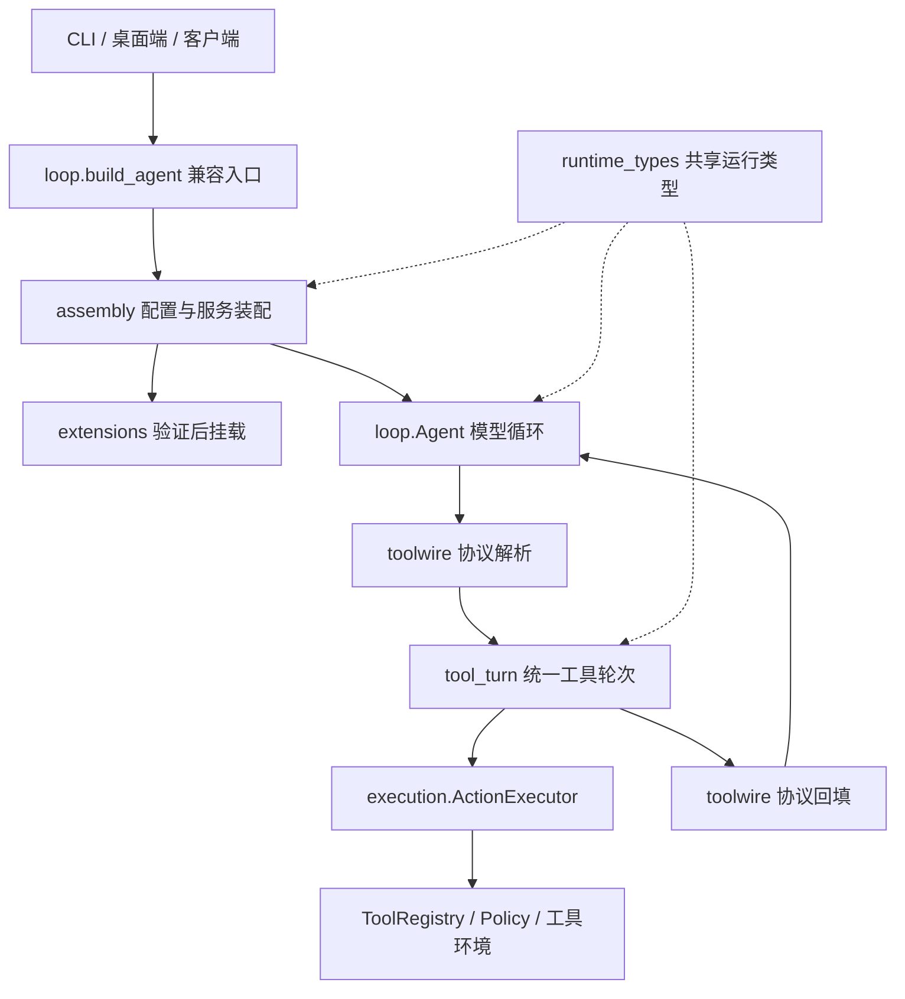

# 从代码结构吸收 Loom：Forge 分层与统一工具执行

本轮接续 `LOOM-INTEGRATION.md`，针对模块职责和真实调用链重构。

## 源码对照

Loom 的 `packages/profiles/src/index.ts` 创建环境组合，`packages/kernel/src/kernel.ts` 消费环境提供的工具；`types.ts` 描述共享协议，`verifier.ts` 负责验收。值得移植的是装配、执行、协议边界，而不是 TypeScript 包目录的名称。

Forge 原 `forge/loop.py` 同时包含配置装配、服务创建、贡献模块发现、运行数据类型、模型循环，以及两段文本/原生工具执行代码。修改工具日志、结果截断、取消或未知结果处理时，需要同步修改两个分支；装配和模块发现变更也会修改核心循环文件。

## 已落地结构

| 文件 | 现在负责什么 | 实际接入点 |
| --- | --- | --- |
| `forge/assembly.py` | 从配置创建工具注册表、记忆、能力库、检查点、会话、成本账本和 Agent | 原 `forge.loop.build_agent()` 转发到这里，现有 CLI/桌面端/客户端继续生效 |
| `forge/extensions.py` | 贡献模块发现、闸门后的扩展挂载、home 覆盖与内置回退、思考引擎整组装配 | `assembly.build_agent()` 调用；旧 `forge.loop` 导出继续可用 |
| `forge/runtime_types.py` | `ThinkingSuite`、`LoopLimits`、`Step`、`RunReport` 的唯一类型定义 | 循环、装配、工具执行共享同一类对象，旧导入路径重导出 |
| `forge/tool_turn.py` | 已规范化工具调用的一轮执行：动作调用、结果外置/截断、Step、日志、重复检测、未知结果停止 | 文本工具协议和 OpenAI/Anthropic 原生工具协议都调用 `execute_turn()` |
| `forge/loop.py` | 组织模型轮次、上下文、子代理、验收、停止和结果生命周期 | 继续作为 Agent 的入口与兼容门面 |
| `forge/toolwire.py` | 厂商/文本协议解析，以及对应格式的工具结果回填 | 留在执行器两侧；协议细节不进入 `tool_turn` |
| `forge/execution.py` | 单次动作的授权、检查点、版本保护、执行、持久化与未知结果语义 | `tool_turn` 通过注入的 `_invoke_recorded()` 进入已有动作执行边界 |

## 统一执行路径的实质变化

之前文本工具分支与原生工具分支分别处理 `Step`、`action_id`、checkpoint、usage、offload、截断、审计、supervisor、unknown 和 stalled。

现在协议层先把两者转成 `ToolCall`。公共执行器不持有整个 Agent，只接收调用函数、事件发布函数、结果外置器、循环检测器和结果上限，返回已回答调用、supervisor 观察和停止原因。这使执行规则可直接测试，也让后续环境扩展只需接入现有工具和动作边界。

- 原生调用 ID 继续传给动作执行器和回填消息；文本调用保留原来的文本回填格式。
- `unknown_outcome` 或 `stalled` 会停止当前批次，后续工具不执行。
- 执行器不新增重试或并行；模型批量调用仍按原顺序执行。
- 原有授权、SecretScope、文件版本防护、检查点和动作日志仍由 `ActionExecutor` / `ToolRegistry` 执行。
- 装配层继续使用原配置含义、贡献模块闸门和回退规则；未新增“环境声明即可获得权限”的机制。

这是职责拆分和重复行为收敛。`loop.py` 从本轮开始时的 **1981 行降至 1596 行**，减少 385 行，约 19.4%；其中大量实现移入对应模块，行数下降本身不代表性能提升。

## 验证

新增 `forge/test_runtime_structure.py` 的 8 项行为测试：两协议结果/用量一致、未知结果阻止后续调用、重复成功/失败停止、权限拒绝审计、长结果证据、外置结果与检查点、异常后不继续派发。

验证日志：

- `reports/loom-structure-core.log`：内核全量回归。
- `reports/loom-structure-runtime.log`：Agent、客户端、开发模式和执行链的 9 组回归。
- `reports/loom-structure-selftest.log`：框架自检。

最终结果：内核 355 项（353 通过、2 跳过），运行时与客户端 188 项（187 通过、1 跳过），合计 **540 通过、3 跳过、0 失败**；框架自检 **595/595**。代码预算清单 138 个文件通过；接受 Windows CRLF 的 Git 空白检查通过。测试使用离线模型和本地 fixture，没有进行真实云模型评测或 GUI 视觉验收。

本轮前快照路径见 `reports/loom-structure-backup.txt`，本轮独立补丁见 `reports/loom-structure.patch`。原有未提交工作和上一轮验收/版本保护集成均保留；Loom 源码只读。本轮没有更换会话存储、迁移工作区或调用真实云端模型。
