# Qt 前端人因工程评审（2026-11-23）

范围：`revon-gui/qt_frontend/`（Work/Chat 主界面、输入框、模型/思考强度/角色/规划控件、Code 模式、设置与模型编辑、工具目录、壁纸、宠物、命令面板、审批卡、空/忙/错状态）。
方法：`--demo` 场景逐面截图（1280×860 与 900×700，150% 缩放），对照下列原则走查；对比度按 WCAG 2.x 公式计算，背景取界面上最亮的玻璃/极光区（实测 `#24384a`）。
截图脚本在仓库外的 `.shots/hf/shots.py`（只用于评审，不进应用）。前后对比图在 [`qt-human-factors/`](qt-human-factors/)。

> 本轮没有真实模型配置下的截图：真实配置只影响模型名长度和思考档位，布局结论与 demo 一致。

## 结论排序（按对用户的影响）

| # | 问题 | 原则 | 影响 | 状态 |
|---|---|---|---|---|
| 1 | 输入框里按 Tab 会写入制表符，键盘无法离开输入框去够模型/思考/角色/发送按钮 | 键盘可达性（WCAG 2.1.2 无键盘陷阱） | 纯键盘用户完全无法操作底栏 | ✅ 已修 |
| 2 | 全界面没有可见的键盘焦点：GlassButton 只在着色器里把 emphasis 调到 0.65，肉眼几乎分辨不出 | 焦点可见（WCAG 2.4.7）、系统状态可见 | 用 Tab 时不知道焦点在哪 | ✅ 已修 |
| 3 | 审批卡半透明，底下的对话内容透过来与待批命令叠在一起；“拒绝/批准本次”同等权重、36px、贴在右下角；没有快捷键，也不提示队列里还有几项 | 可读性、视觉层级、Fitts、按风险确认 | 批准 `rm -rf` 这类命令时最需要看清，反而最难看清 | ✅ 已修 |
| 4 | 发送按钮是暗蓝色玻璃上的暗箭头，比旁边的“全栈开发师”角色按钮还不显眼；运行中变成同色方块，停止键难找 | 视觉层级 / 前注意属性（主操作应最醒目）、Fitts | 最高频操作不是最显眼的 | ✅ 已修 |
| 5 | 长回合只有底部 11px 灰字状态（对比度约 3.4:1），没有计时、没有动效，看不出是在干活还是卡住了 | Nielsen #1 系统状态可见 | 用户在长任务里反复怀疑是否卡死 | ✅ 已修 |
| 6 | `textMuted`/`textDim` 在亮玻璃上只有 3.76:1 / 2.68:1；状态栏、会话副标题、分组标题等硬编码灰（`#7e8998`、`#7f8b99`…）约 3.2–3.4:1，且 11px CJK | 可读性（WCAG 1.4.3 AA 4.5:1）、CJK 最小字号 | 中文小字在壁纸/极光上发虚 | ✅ 已修（token 级） |
| 7 | “连接与外观”是 8 个同宽同权重的整行按钮，网关、模型、壁纸、宠物、玻璃混排 | Hick 定律、格式塔接近性 | 找“壁纸”要扫完整列 | ✅ 已修 |
| 8 | 回复下方“复制 / 重试 / 继续”是带 TapHandler 的文字，12px、不可 Tab、无焦点；与用户消息上的“编辑/撤回”（GlassButton）样式不一致 | Fitts、一致性、键盘可达 | 小目标，且键盘无法复制回复 | ✅ 已修 |
| 9 | 退出确认里“继续工作 / 确认退出”同等权重、无默认焦点，回车不知道会触发哪个 | 错误预防、按风险确认 | 误退出会停止正在运行的任务 | ✅ 已修 |
| 10 | 命令面板打开时没有任何高亮行，回车目标不明确。根因是行代理（AbstractButton）里的 `palette` 解析成了控件自身的 `Control.palette` 而不是弹窗 id：高亮条件恒为假，悬停/点击也到不了 `runCurrent()` | 识别优于回忆、反馈 | 键盘用户不知道回车会执行哪条；鼠标点选命令无效 | ✅ 已修 |
| 11 | 错误横幅整块可点但会**打开设置**（隐藏动作），且无法关闭 | 一致性、用户控制 | 点一下想选中错误文本，却弹出设置 | ⏳ 未修，见后续 |
| 12 | 侧栏底部“沙箱运行”权限按钮常驻 `selected` 高亮，与“当前选中”语义冲突；运行时变灰却不说明原因 | 状态色只表示状态、可见性 | 用户以为它是被选中的页面 | ⏳ 未修 |
| 13 | 启动动画（Launch.qml）与宠物弹跳不读 `reduceMotion`；启动动画总时长约 1.4 s | 动效有目的、尊重减少动态 | 前庭敏感用户不适；冷启动多等一秒 | ⏳ 未修 |
| 14 | 输入框底栏左侧 4 个、右侧 3–4 个控件，900px 宽时“规划/搜索/工具”退化成纯图标 | Hick、识别优于回忆 | 窄窗口下要靠 tooltip 回忆图标含义 | ⏳ 未修（已有 tooltip，影响中等） |
| 15 | 欢迎页角色 chip 两行 8 个 + 4 个示例，首次进入选择项偏多 | Hick、渐进披露 | 首屏信息密度偏高 | ⏳ 未修 |

## 已做的修改

全部优先走 token / 基础组件，而不是逐处调像素：

- **Theme.qml**（token）
  - `textMuted #8291a4 → #9eabbb`（亮玻璃上 3.76 → 5.2:1），`textDim #68788c → #8392a5`（2.68 → 3.8:1，仅装饰/禁用）。新增 `captionSize: 12`（CJK 说明文字下限）。
  - 新增 `primaryFill / primaryFillHover / primaryBorder`（主操作实心）、`focusRing / focusRingWidth`（只用于焦点）、`overlayCard / scrim`（不透明卡片与遮罩）、`warningBorder`。
- **GlassButton.qml**（全局生效）
  - `primary` 在玻璃上叠一层实心主色，成为表面上唯一的实心控件（发送、保存、批准）。
  - `visualFocus` 时在控件外 3px 画 2px 焦点环；新增 `danger`（危险操作用危险色文字，不会被当成默认项）。
- **ComposerText.qml**：`tabNavigates`（默认等于 `submitOnEnter`）——聊天输入框 Tab/Shift+Tab 移动焦点；代码/文档编辑器（`submitOnEnter: false`）仍插入制表符。输入法组字时不拦截。
- **Main.qml**
  - 发送/停止：同一个 40px 圆形实心目标；运行中外圈 2px 呼吸环（`reduceMotion` 时静止）。tooltip 标出 Enter / Esc。
  - 回合状态：底部状态行在运行中显示“状态 · 已用 N 秒 · Esc 停止”，带状态点，颜色提升到 `textSecondary`；空闲时显示原状态。快捷提示补上“Tab 移到按钮”。
  - 审批：遮罩 + 不透明卡片 + 警告色描边与盾形图标；命令详情放进等宽字体的深色代码框；“批准本次”为实心主按钮、“拒绝”带 ×，两者 40px 高、≥112px 宽；队列 >1 时显示“还有 N 项”。键盘：**单独 Enter 不做任何事**（防止还在输入框打字时误批），Ctrl+Enter 批准，Esc 拒绝；审批期间 Esc 不再触发“停止回合”。
  - 设置：分成“连接 / 模型 / 外观”三组，网关地址与“应用并连接”并排，外观三项一行；页脚放渲染状态与“打开完整工作台”。弹窗改用显式 x/y/height 居中。
  - 回复操作：复制 / 重试 / 继续改成 30px quiet GlassButton，可 Tab，与“编辑/撤回”一致；“已停止/回复未完成”带警告图标。
  - 退出确认：焦点默认在“继续工作”，“确认退出”为 `danger`。
  - 侧栏/欢迎页硬编码灰改用 `Theme.textMuted` + `captionSize`；会话列表项加焦点环。
- **CommandPalette.qml**：弹窗 id 由 `palette` 改为 `paletteRoot`（修复上面的作用域遮蔽）；当前行用 `selectedTint` + 左侧主色竖条。

保留不变：玻璃/极光材质与着色器、壁纸库、桌面宠物与启动动画、角色模板、思考强度滑杆、模型编辑器、命令面板、Code 模式工具链、专家模型设置。

## 前后对比

| 场景 | 之前 | 之后 |
|---|---|---|
| 对话页 | 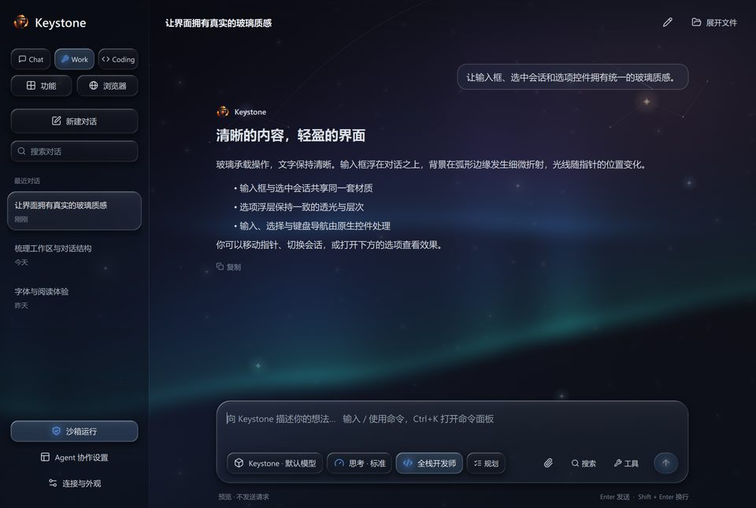 | 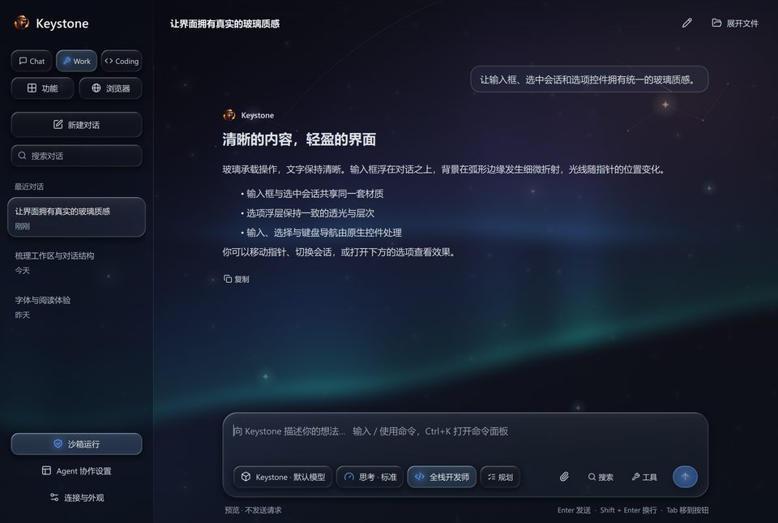 |
| 运行中 | 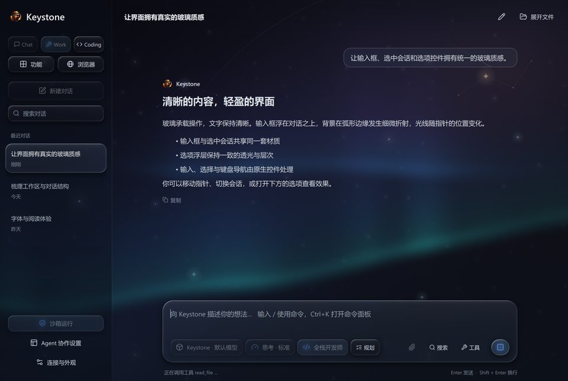 |  |
| Tab 三次后的焦点 | 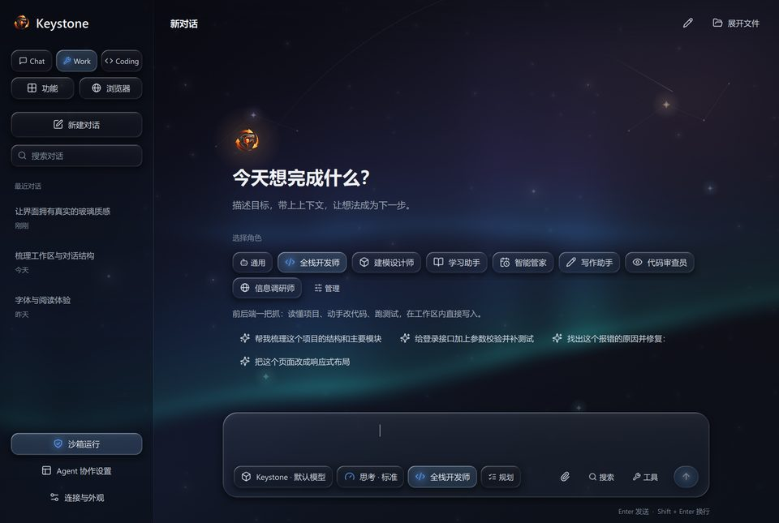 |  |
| 审批 | 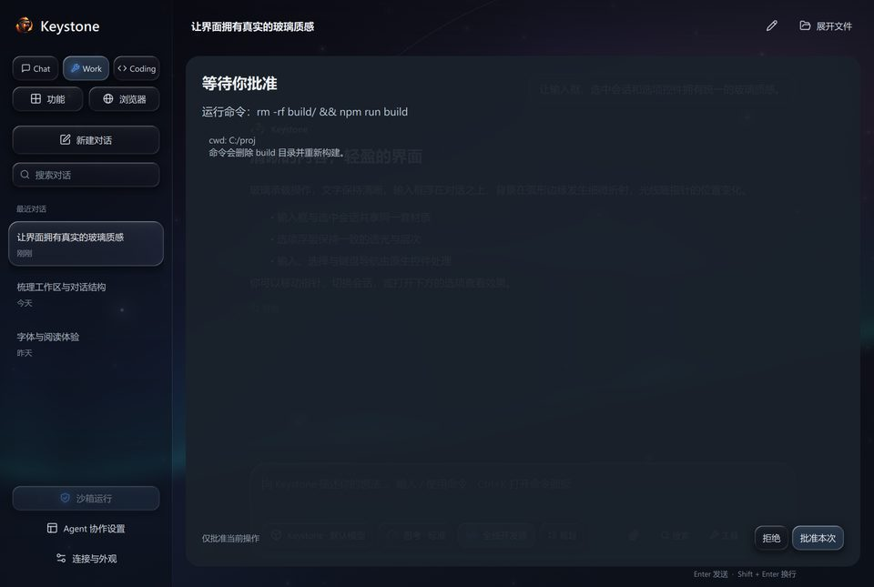 | 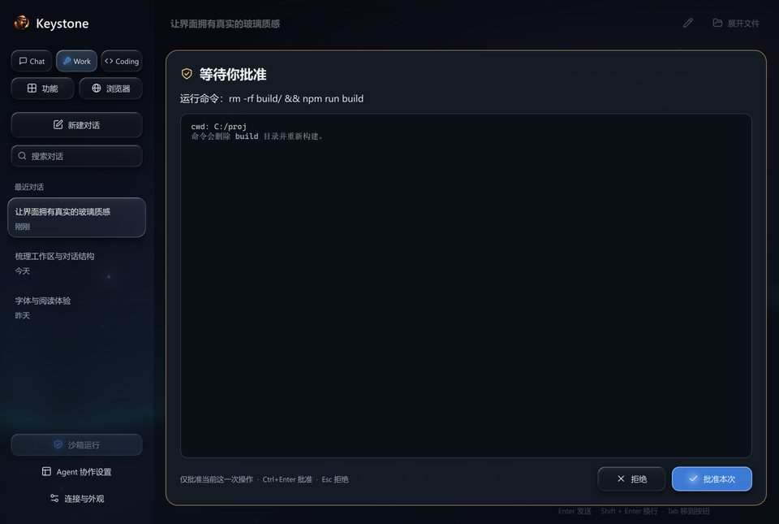 |
| 连接与外观 | 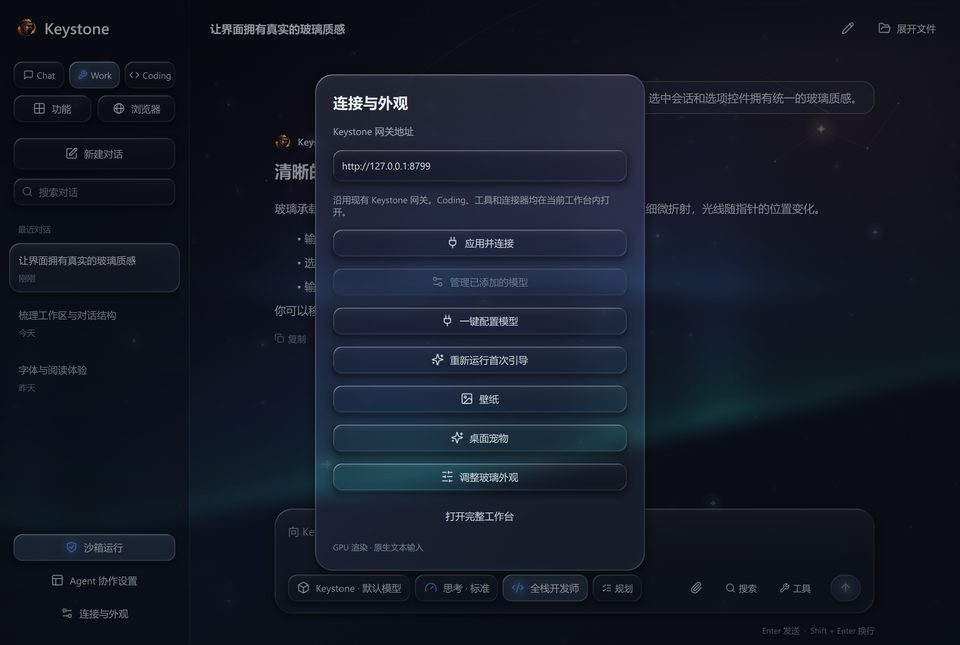 | 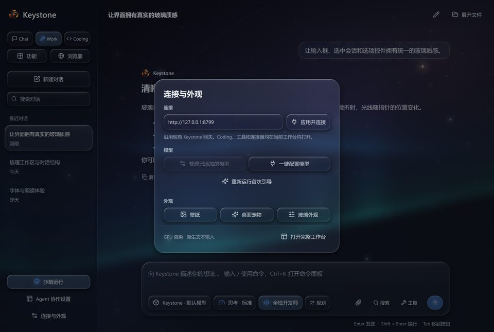 |
| 命令面板 | 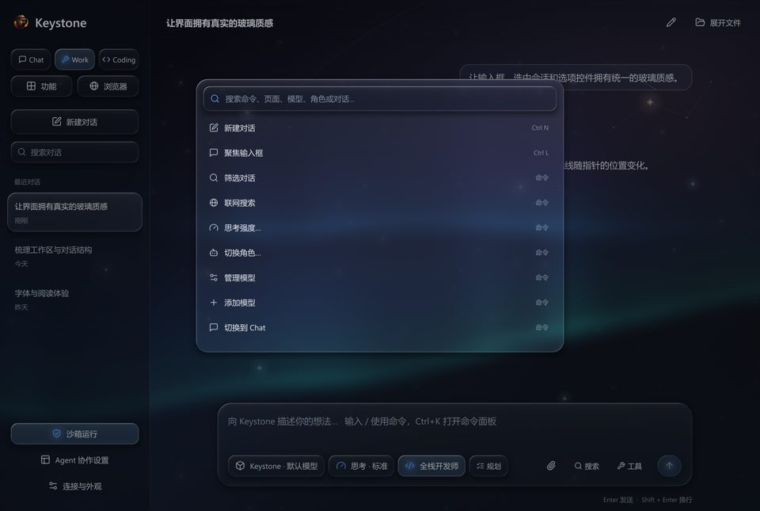 | 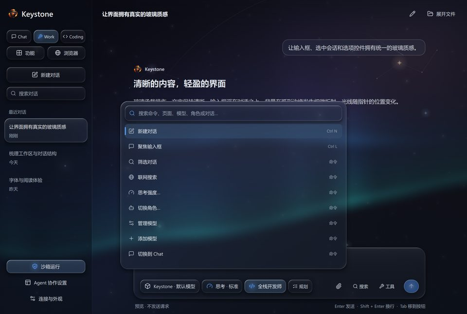 |
| 退出确认 | 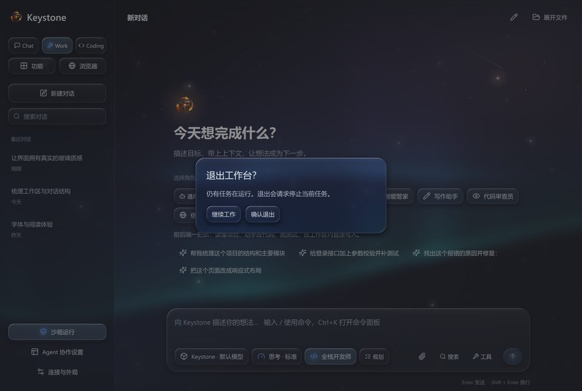 |  |
| 错误 |  | 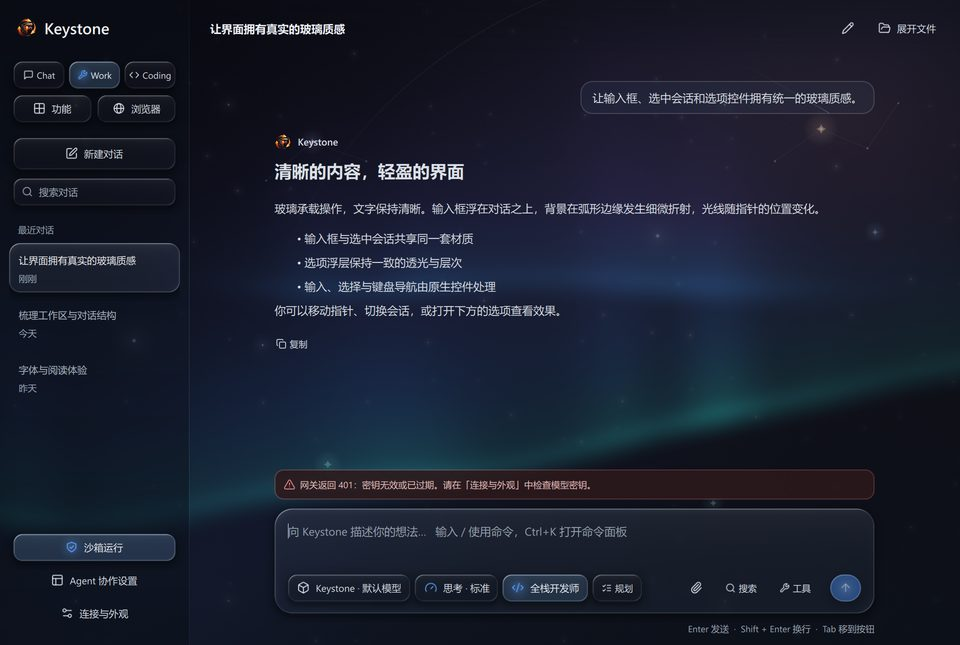 |

## 测试

`qt_frontend/test_human_factors.py`：
- token 对比度：`textPrimary/Secondary/Muted` 在最亮玻璃上 ≥ 4.5:1，`textDim` ≥ 3:1，焦点环对所有底色 ≥ 3:1；
- Tab 离开聊天输入框且草稿不变、焦点环可见、Shift+Tab 回到输入框；代码编辑器仍插入 `\t`；
- 发送/停止始终是 ≥40px 的 primary，运行中呼吸环可见，状态行含已用时间与 “Esc 停止”；
- 审批：卡片获得焦点；单独 Enter 无效；Ctrl+Enter 批准；Esc 拒绝且不会停止回合；队列计数；处理完焦点回到输入框；
- 设置三组可见且不超出窗口；退出确认默认焦点在“继续工作”，回车不会退出；
- 回复“复制”是可 Tab 的 ≥30px 按钮；
- 命令面板打开即高亮第一行，点击行会执行该命令（作用域遮蔽回归）。

## 后续（未在本轮处理）

1. 错误横幅：去掉整块点击打开设置，改为“检查连接”按钮 + 关闭按钮（#11）。
2. 权限按钮改用中性样式 + 权限色点，运行中禁用时 tooltip 说明原因（#12）。
3. `Launch.qml` / `PetWindow.qml` 接入 `reduceMotion`，启动动画缩到 ≤ 600 ms 或可跳过（#13）。
4. 窄窗口底栏：把“搜索/工具/附件”收进一个“更多”菜单，保留文字标签（#14）。
5. 欢迎页角色 chip 只显示最近使用的 4 个 + “全部角色…”（#15）。
6. 用真实配置（长模型名、5 档思考、专家模型开启）补一轮截图。
